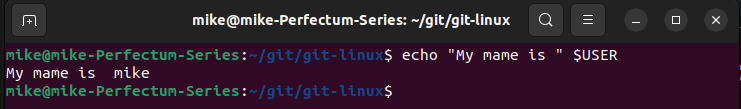
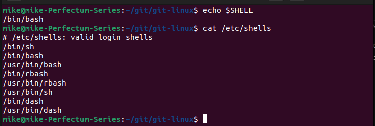
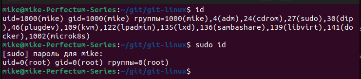

# Домашнее задание к занятию "Знакомство с операционной системой Linux"

### Цель задания

В результате выполнения этого задания вы:
- установите на своё рабочее место виртуальную машину и развернете в ней ОС Linux,
- начнете работать с терминалом, установив приложение.


### Инструменты/ дополнительные материалы, которые пригодятся для выполнения задания

1. Видеолекция в личном кабинете "Настройка виртуального рабочего места"
2. [Как включить аппаратную виртуализацию (VT) в Windows 10](https://support.bluestacks.com/hc/ru/articles/360058102252-%D0%9A%D0%B0%D0%BA-%D0%B2%D0%BA%D0%BB%D1%8E%D1%87%D0%B8%D1%82%D1%8C-%D0%B0%D0%BF%D0%BF%D0%B0%D1%80%D0%B0%D1%82%D0%BD%D1%83%D1%8E-%D0%B2%D0%B8%D1%80%D1%82%D1%83%D0%B0%D0%BB%D0%B8%D0%B7%D0%B0%D1%86%D0%B8%D1%8E-VT-%D0%B2-Windows-10-%D0%B4%D0%BB%D1%8F-BlueStacks-5)
3. [Unix shell: абсолютно первые шаги](https://habr.com/ru/post/267825/)
4. [Установка программ](https://help.ubuntu.ru/wiki/%D1%83%D1%81%D1%82%D0%B0%D0%BD%D0%BE%D0%B2%D0%BA%D0%B0_%D0%BF%D1%80%D0%BE%D0%B3%D1%80%D0%B0%D0%BC%D0%BC)


### Задание 1

1. Подготовьте рабочее пространство:

- Скачайте с сайта [VirtualBox](https://www.virtualbox.org/) и установите на свой компьютер
- Создайте новую виртуальную машину
- Скачайте [Ubuntu](https://ubuntu.com/download/desktop)
- Установите Ubuntu на вашу виртуальную машину

**Примечание:** Если у вас операционная система macOS или Linux, воспользуйтесь [инструкцией](macOs-instr.md).

*Сделайте скриншот консоли, где в строке ввода будет ваше ФИО.*



### Задание 2

Запустите терминал и выполните команды:

- echo $SHELL
- cat /etc/shells

*Ответ приведите в виде снимка экрана и прокомментируйте в свободной форме результаты выполнения указанных команд*



```
# echo $SHELL - вывод интерпретатора командной строки данного пользователя

# cat /etc/shells - доступные в системе интерпретаторы командной строки
```

### Задание 3

Установите при помощи утилиты **apt** файловый менеджер **mc**. 

*Решение приведите в виде последовательности команд или снимка экрана*

```
# Обновление списка пакетов репозитория:
sudo apt update

# Установка пакета mc:
sudo apt install mc
```

### Задание 4* (необязательно выполнение)

Выполните следующие команды:

1. id
2. sudo id

*Объясните, почему вывод одной и той же команды отличается в этих случаях.*



```
# id - информация о текущем пользователе

# sudo id - информация о суперпользователе root (команда sudo выполняется от лица суперпользователя)
```