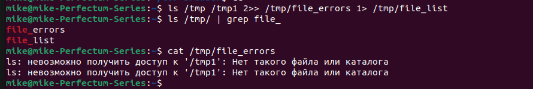

# Домашнее задание к занятию "Процессы, управление процессами"

### Цель задания
В результате выполнения этого задания вы научитесь работать с процессами ОС Linux, перенаправление потоков ввода-вывода и каналами.
В результате выполнения этого задания вы научитесь:
1. Работать с процессами ОС Linux.
2. Перенаправлять потоки ввода-вывода.
3. Работать с каналами.

### Инструменты/ дополнительные материалы, которые пригодятся для выполнения задания

1. [Изучаем процессы в Linux](https://habr.com/ru/post/423049/)
2. [Список процессов](https://losst.pro/spisok-protsessov-linux)
3. [Перенаправление ввода/вывода в Linux](https://selectel.ru/blog/tutorials/linux-redirection/)
4. [Стандартные потоки ввода/вывода](http://xgu.ru/wiki/%D0%A1%D1%82%D0%B0%D0%BD%D0%B4%D0%B0%D1%80%D1%82%D0%BD%D1%8B%D0%B5_%D0%BF%D0%BE%D1%82%D0%BE%D0%BA%D0%B8_%D0%B2%D0%B2%D0%BE%D0%B4%D0%B0/%D0%B2%D1%8B%D0%B2%D0%BE%D0%B4%D0%B0)

------

### Задание 1

Измените команду ```ls /tmp /tmp1```так, чтобы:

1. Результат работы (список файлов) для текущего запуска команды выводился в файл /tmp/file_list.
2. Ошибки для каждого запуска добавлялись в файл /tmp/file_errors.

Примечание к заданию:
1. Создавать /tmp1 не требуется. Директория должна отсутствовать для генерации вывода stderr.
2. Задание необходимо выполнить одной командой.

*В качестве решения пришлите полученную команду и скриншот терминала с выводом содержимого созданных файлов*

```
ls /tmp /tmp1 2>> /tmp/file_errors 1> /tmp/file_list
```


------

### Задание 2

Напишите команду, которая выводит все запущенные процессы пользователя root в файл *"user_root_ps"*.

```
ps -U root -u root u > user_root_ps
```

------

### Задание 3

Начинающий администратор захотел вывести все запущенные процессы пользователя с логином "2" в файл *"user_2_ps"*.

Для этого он набрал команду:

```
ps -U 2> user_2_ps
```

Затем, он аналогично повторил для пользователя с логином "5" вывод в файл "user_5_ps":

```
ps -U 5> user_5_ps
```

**Вопрос:**

Почему вывод этих команд и содержимое файлов сильно отличаются друг от друга?  Как должны выглядеть правильные команды?

**Примечание:**

Если у вас в системе нет пользователей "2" и/или "5" (это нормальная ситуация), то утилита ps выводит только одну строку:

```
 PID TTY          TIME CMD     
```

*Ответ приведите в виде снимка экрана с комментариями в свободной форме.*

```
# ps -U 2> user_2_ps - запись в файл стандартного потока ошибок (2>). Чтобы хаписать в файл список процессов пользователя 2, следует поставить пробел между символами 2 и >:
ps -U 2 > user_2_ps

# ps -U 5> user_5_ps - запись в файл списка процессов пользователя 5. В POSIX нет зарезервированного символа "5>", поэтому команду можно записывать без пробела между 5 и >
```