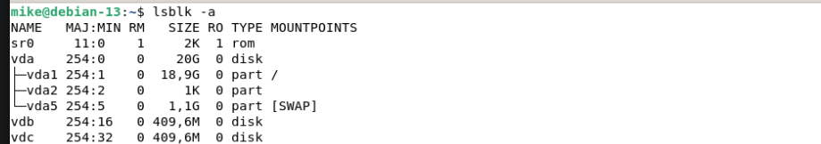
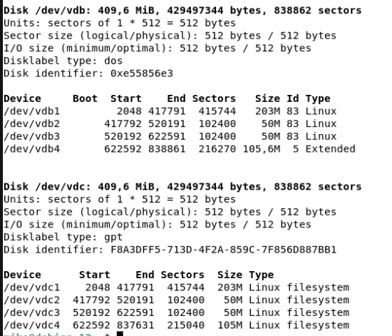
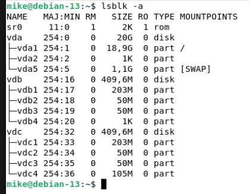
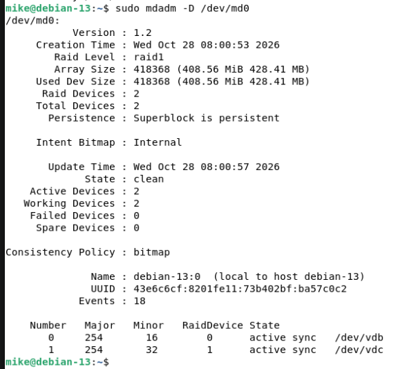
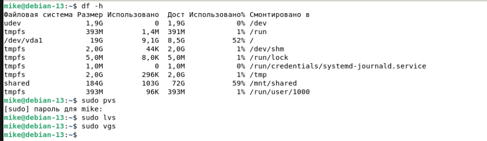
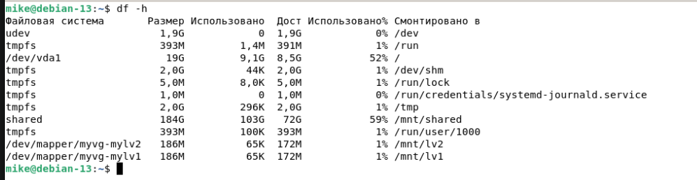
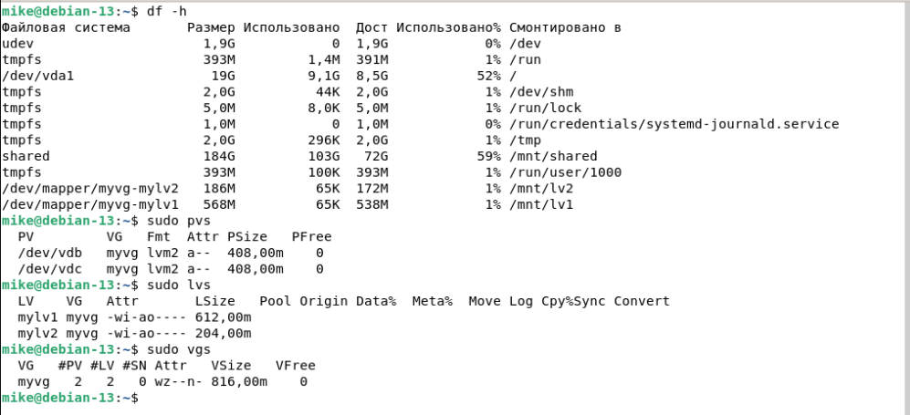

# Домашнее задание к занятию "Дисковые системы"

### Цель задания

В результате выполнения этого задания вы:

1. Закрепите понимание работы дисковых систем в GNU/Linux.
2. Приобретете практические навыки настройки и администрирования блочных устройств в GNU/Linux.

### Инструменты/ дополнительные материалы, которые пригодятся для выполнения задания

1. [Знакомство с технологией RAID](http://rus-linux.net/MyLDP/BOOKS/LSA/ch10.html)   
2. [Виртуальные файловые системы в Linux](http://rus-linux.net/MyLDP/file-sys/Virtual_filesystems_in_Linux.html)   
3. [Основы работы с утилитой mdadm](http://xgu.ru/wiki/mdadm)

---

### Задание 1

Какие виды RAID увеличивают производительность дисковой системы?

*Приведите ответ в свободной форме.*

```
- RAID 0 — лучший выбор для максимальной производительности, но без отказоустойчивости.
- RAID 1 - увеличивает скорость чтения за счет того, что чтение производится параллельно сразу с 2-х дисков, но это зависит от реализации RAID-контроллера или программного обеспечения, управляющего массивом(Требуется поддержка балансировки нагрузки).
- RAID 10 — оптимальный баланс производительности и надежности, но требует больше дисков.
- RAID 5/6 — подходят для задач, где важны надежность и эффективное использование дискового пространства, но производительность записи ниже.
- RAID 50/60 - тоже увеличивают производительность, являясь комбинацией рейдов 5+0 и 6+0, однако: требуется больше дисков для реализации; потеря на избыточность; восстановление данных после сбоя более сложное и долгое.
```

### Задание 2

Назовите преимущества использования VFS. Используется ли VFS при работе с tmpfs? Почему?

*Приведите развернутый ответ в свободной форме.*

```
Преимущества VFS:

1. Абстракция и унификация: VFS предоставляет единый интерфейс для работы с различными типами файловых систем (например, ext4, NTFS, FAT32), что позволяет приложениям взаимодействовать с файлами и каталогами независимо от их физической реализации.
2. Поддержка множества файловых систем: VFS позволяет операционной системе поддерживать одновременно несколько разных файловых систем, что делает её гибкой и универсальной.
3. Упрощение разработки: Разработчикам приложений не нужно учитывать особенности каждой файловой системы, так как VFS предоставляет общий API для работы с файлами.
4. Прозрачность: Пользователи и приложения могут работать с файлами, не задумываясь о том, на какой файловой системе они хранятся.
Расширяемость: Добавление поддержки новой файловой системы требует лишь реализации соответствующих функций в ядре, не затрагивая приложения, работающие через VFS.

VFS используется при работе с tmpfs. 

tmpfs — это файловая система, которая существует в оперативной памяти. Для того чтобы приложения могли взаимодействовать с файлами в tmpfs так же, как и с файлами на диске, она должна быть интегрирована в общую модель файловой системы ОС. VFS обеспечивает эту интеграцию.
Благодаря VFS приложения могут использовать стандартные системные вызовы (например, open, read, write) для работы с файлами в tmpfs, как если бы они находились на диске.
```

### Задание 3

Подключите к виртуальной машине 2 новых диска. 

1. На первом диске создайте таблицу разделов MBR, создайте 4 раздела: первый раздел на 50% диска, остальные диски любого размера на ваше усмотрение. Хотя бы один из разделов должен быть логическим.

2. На втором диске создайте таблицу разделов GPT. Создайте 4 раздела: первый раздел на 50% диска, остальные любого размера на ваше усмотрение.

*В качестве ответа приложите скриншоты, на которых будет видно разметку диска (например, командами lsblk -a; fdisk -l)*


```
# Разметить диск vdb:
sudo fdisk /dev/vdb

# Создать на нем таблицу MBR (DOS):
o

# Создать первый раздел:
n

# Сделать его первичным:
p

# Задать номер раздела:
1

# Задать размер раздела (половину дискового пространства):
+203M

# Создать второй раздел:
n

# Сделать его первичным:
p

# Задать номер раздела:
2

# Задать размер раздела:
+50M

# Создать третий раздел:
n

# Сделать его первичным:
p

# Задать номер раздела:
3

# Задать размер раздела:
+50M

# Создать четвертый раздел:
n

# Сделать его расширенным (логическим):
e

# Задать номер раздела:
4

# Задать размер раздела по умолчанию

# Сохранить изменения
w

# Разметить второй диск:
sudo fdisc /dev/vdc

# На втором диске создать таблицу GPT:
g

# Далее все как на первом диске
```




### Задание 4

Создайте программный RAID 1 в вашей ОС, используя программу `mdadm`.

Объем RAID неважен.

*В качестве ответа приложите скриншот вывода команды `mdadm -D /dev/md0`, где md0 - это название вашего рейд массива (может быть любым).*

```
# Обнулить суперблоки на дисках vdb и vdc:
sudo mdadm --zero-superblock --force /dev/vd{b,c}

# Создание RAID-массива md0:
sudo mdadm --create --verbose /dev/md0 -l 1 -n 2 /dev/vd{b,c}

# Просмотр информации о массиве:
mdadm -D /dev/md0
```


---

## Дополнительные задания (со звездочкой*)

### Задание 5*

Влияет ли количество операций ввода-вывода на параметр `load average`?

*Приведите развернутый ответ в свободной форме.*

```
Load average — это метрика, которая показывает среднюю нагрузку на систему за определенные промежутки времени (обычно 1, 5 и 15 минут). 
Количество операций ввода-вывода (I/O) может влиять на параметр load average по следующим причинам:
- Если процесс выполняет операции ввода-вывода (например, чтение или запись на диск), он может перейти в состояние ожидания. В этом состоянии процесс не использует CPU, но он всё ещё учитывается в load average, так как ожидает завершения I/O.
- Если дисковая подсистема перегружена (например, из-за большого количества операций чтения/записи), процессы, ожидающие завершения I/O, будут дольше находиться в состоянии ожидания. Это увеличивает load average, даже если CPU не загружен.
- Если множество процессов одновременно выполняют операции ввода-вывода, это может привести к увеличению load average

```

### Задание 6*

1. Сделайте скриншоты вывода комманд `df -h`, `pvs`, `lvs`, `vgs`.



2. Подключите к ОС 2 новых диска.
```
# Подключены диски vdb и vdc
lsblk
```


3. Создайте новую VG, добавьте в него 1 диск.
```
# Создать физический том на диске vdb:
sudo pvcreate /dev/vdb

# Создать группу томов myvg, состоящую из физического тома:
sudo vgcreate myvg /dev/vdb
```
4. Создайте 2 LV, распределите доступное пространство между ними поровну.
```
# Создать логический том mylv1 в группе томов myvg, занимающий 50% объема:
sudo lvcreate -l 50%VG myvg -n mylv1

# Создать логический том mylv2 в группе томов myvg, занимающий оставшееся место:
sudo lvcreate -l 100%FREE myvg -n mylv2
```
5. Создайте на обоих томах файловую систему `ext4`.
```
sudo mkfs.xfs /dev/myvg/mylv1
sudo mkfs.xfs /dev/myvg/mylv2
```
6. Создайте две точки монтирования и смонтируйте каждый из томов.
```
sudo mkdir /mnt/lv1
sudo mkdir /mnt/lv2

sudo mount /dev/myvg/mylv1 /mnt/lv1
sudo mount /dev/myvg/mylv2 /mnt/lv2
```
7. Сделайте скриншот вывода комманд `df -h`.



8. Добавьте в VG второй оставшийся диск.
```
# Создание физического тома на втором диске:
sudo pvcreate /dev/vdс

# Расширение VG myvg на размер второго диска:
sudo vgextend myvg /dev/vdc
```
9. Расширьте первый LV на объем нового диска.   
```
sudo lvresize -l +100%FREE myvg/mylv1
```
10. Расширьте файловую систему на размер нового доступного пространства.
```
sudo resize2fs /dev/myvg/mylv1
```   
11. Сделайте скриншоты вывода комманд df -h, pvs, lvs, vgs.



*В качестве ответа приложите созданные скриншоты и скриншоты выполнения.*