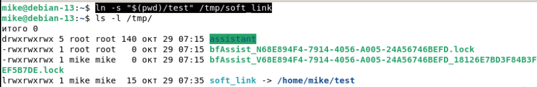
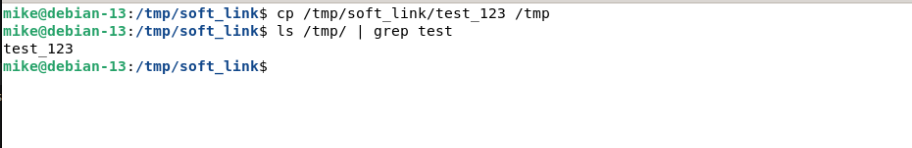
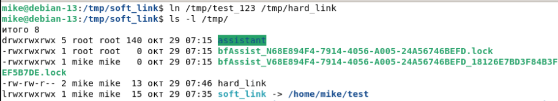
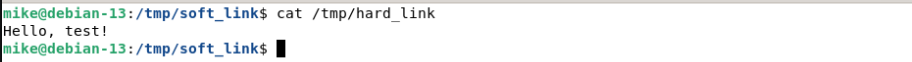
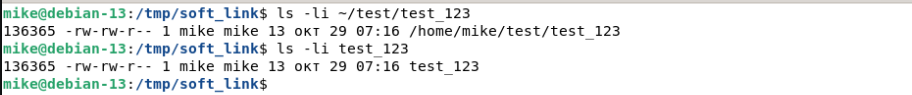
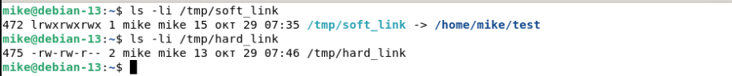
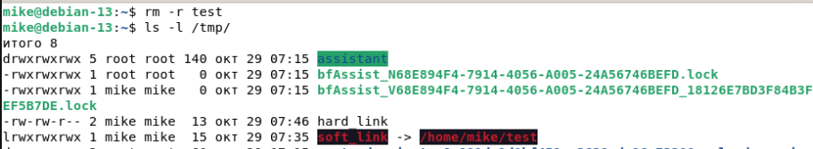
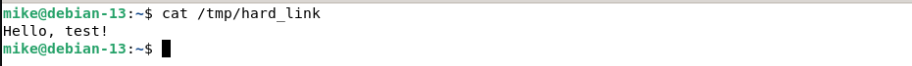

# Домашнее задание к занятию "Файловые системы"

### Цель задания

В результате выполнения этого задания вы:

* научитесь работать с жёсткими и символьными ссылками,
* закрепите навык работы с файлами и каталогами,
* научитесь форматировать и монтировать разделы в ОС Linux.

### Инструменты и дополнительные материалы, которые пригодятся для выполнения задания

1. [Cтатья про BTRFS](https://habr.com/ru/company/veeam/blog/458250/).
2. [Статья про монтирование](http://xgu.ru/wiki/%D0%9C%D0%BE%D0%BD%D1%82%D0%B8%D1%80%D0%BE%D0%B2%D0%B0%D0%BD%D0%B8%D0%B5).


---

### Задание 1

1. Создайте каталог `~/test` и в нём файл `test_123` с любым содержимым.
```
mkdir test

cat > test/test_123
Hello, test!

Ctrl+D
```
2. Создайте символическую ссылку на каталог `~/test` по пути `/tmp/soft_link`.
```
ln -s "$(pwd)/test" /tmp/soft_link
```

3. Используя ссылку `/tmp/soft_link`, скопируйте файл `test_123` в каталог `/tmp` с тем же именем.
```
cp /tmp/soft_link/test_123 /tmp
```

Создайте жёсткую ссылку на файл `/tmp/test_123` с именем `/tmp/hard_link`.
```
ln /tmp/test_123 /tmp/hard_link
```


*Вопрос 1. Файлы ~/test/test_123 и /tmp/test_123 — это один и тот же файл (одинаковые inode)?*


```
Да. Это один и тот же файл: номер inode совпадают
```
*Вопрос 2. Файл /tmp/soft_link и /tmp/hard_link — это один и тот же файл (одинаковые inode)?*
```
Это разные файлы
```

*Вопрос 3. Файл /tmp/test_123 и /tmp/hard_link — это один и тот же файл (одинаковые inode)?*
```
Один и тот же файл
```


*Вопрос 4. Докажите, что одна из ссылок символическая, а другая жёсткая. Обязательно приложите к ответу скриншоты команд, которые иллюстрируют различия ссылок разного типа, или, если не уверены, ход решения задания.*
```
# Если удалить каталог ~/test, символьная ссылка перестанет работать, а жесткая продолжит открываться:
```



### Задание 2

1. Создайте файл `~/netology`.
2. Создайте каталог `~/netology/`.
3. Поместите файл `netology` в каталог `netology`.

*Какое или какие из трёх действий невозможно выполнить? Почему?*

---

### Задание 3

1. Как посмотреть количество `inodes`?
2. В каких файловых системах не может возникнуть проблемы нехватки `inodes`?

*Запишите ответ в свободной форме.*

---

### Задание 4

Задание не предполагает использования LVM.

1. Подключите к системе новый диск 3 Гб.
2. Создайте на диске один раздел размером 2 Гб.
3. Разметьте раздел как `xfs`.
4. Смонтируйте раздел по пути /mnt. Создайте любой файл на смонтированной файловой системе. Сделайте скриншот вывода команды df -hT.
5. Увеличьте раздел до 3 Гб.
6. Расширьте файловую систему на новое свободное пространство.
7. Убедитесь, что после всех манипуляций созданный вами файл остался внутри раздела и файловой системы.
8. Сделайте скриншот вывода команды df -hT.

*В качестве ответа приложите два сделанных скриншота.*


## Задание со звёздочкой*
Дополнительное задание необязательно к выполнению и не повлияет на получение зачёта по этой домашней работе. Вы можете его выполнить, чтобы глубже разобраться в материале.

---

### Задание 5*

Создайте файловую систему `Btrfs` на двух дисках по 5 Гб каждый.

*Сколько места будет доступно для работы с файлами? Сколько места займут метаданные?*