# 50 заданий на тему "`Linux`"

## Раздел 1: Основы работы с терминалом и файловой системой (Задания 1-10)


### Задание 1. Навигация и информация:

- Откройте терминал. 

`Сочетание клавиш Ctrl + Alt + T`

- Определите, в какой директории вы находитесь.

```
pwd
```
- Перейдите в корневую директорию /, затем в /var/log.

```
cd /; cd /var/log
```
- Выведите на экран содержимое этого каталога в виде списка с подробной информацией (включая скрытые файлы) и отсортируйте его по времени изменения, чтобы новейшие файлы были вверху.

```
ls -lat
```
`- l - подробная информация`

`- a - отобразить скрытые файлы`

`- t - сортировка по времени изменения (сначала свежие)`

---

### Задание 2. Работа с историей:

- Выполните команды `ls -la`, `pwd`, `cd /tmp`, `echo "Hello"`.
- Используя историю команд, выполните команду `ls -la` снова, не набирая ее заново:
```
history
!1973       # 1973 - номер команды в истории
```
---

### Задание 3. Создание и удаление файлов/каталогов:

- В вашей домашней директории создайте структуру каталогов: `~/project/{src,bin,docs,backup}`:

```
mike@debian-kvm:~$ mkdir -p ~/project/{src,bin,docs,backup}
```
- Внутри `~/project/src` создайте файлы `main.c` и `README.md`:

```
touch ~/project/src/{main.c,README.md}
```
- Создайте пустой файл `.config` в `~/project`:

```
touch ~/project/.config
```
- Удалите каталог `~/project/backup` вместе со всем его содержимым (создавать ничего не нужно, просто удалите):

```
rm -r ~/project/backup
```
---

### Задание 4. Символические и жесткие ссылки:

- В вашей домашней директории создайте файл `original.txt` с текстом "Это оригинал".

```
cat > original.txt
Это оригинал
Ctrl + D
```
- Создайте жесткую ссылку на него с именем `hardlink.txt`:

```
ln original.txt hardlink.txt
cat hardlink.txt
```
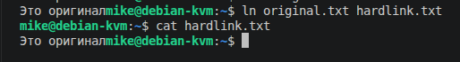

- Создайте символическую ссылку на него с именем softlink.txt:

```
ln -s original.txt softlink.txt
```
- Удалите оригинальный файл `original.txt`:

```
rm original.txt
```
- Проверьте, что теперь содержится в файлах `hardlink.txt` и `softlink.txt`. Объясните результат.

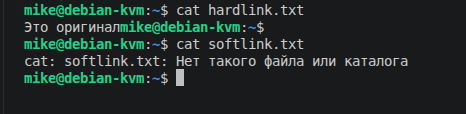

`Softlink - это ярлык на файл original.txt. При удалении файла original.txt ярлык становится "битым"`

`Hardlink - еще одно имя данных хранящихся на диске. Также как и original.txt. При удалении original.txt сами данные не удаляются. Соответственно, при обращении к hardlink.txt содержимое данных успешно отображается`

---

### Задание 5. Поиск файлов (find): 

- Найдите в вашей домашней директории все файлы с расширением `.txt`, которые были изменены за последние 24 часа.

```
find . -type f -mtime -1
```
`-mtime -1 - интервал времени, в течении которого был редактирован файл (в сутках)`

- Найдите все файлы в системе, размер которых превышает 100 МБ, и выведите их список с размерами в удобочитаемом формате (используйте `exec` и `du -h`).

```
sudo find / -type f -size +100M -exec du -h {} \;  2>null
```
`-exec du -h {} \; - выполнить команду du (disk usage) в читаемой форме (-h) для каждого найденного файла`

---

### Задание 6. Права доступа:

- Создайте файл [script.sh](script.sh) с содержимым `#!/bin/bash\necho "Hello"`:

```
cat > script.sh

#!/bin/bash                                                      

echo "Hello"

Ctrl + D
```
- Сделайте его исполняемым для владельца и группы, но не для остальных:

```
chmod u+x,g+x script.sh
```
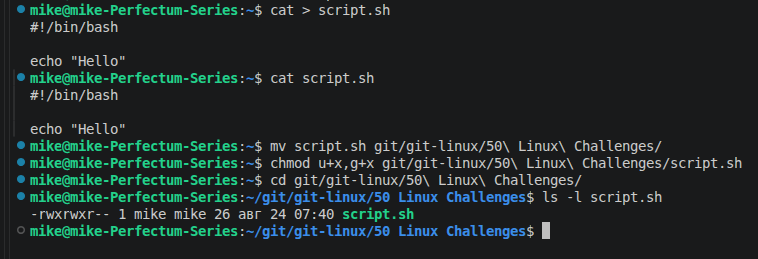

- Затем, используя числовой метод, установите права `-rwxr-x---`. Проверьте результат.

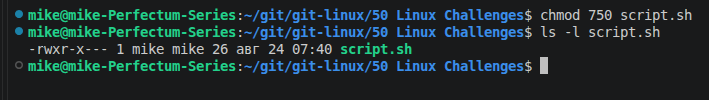

---

### Задание 7. Потоки ввода-вывода: 

- Выполните команду `ls /root /etc`:

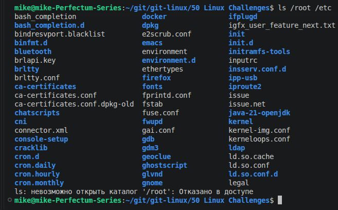

- Перенаправьте ее стандартный вывод в файл `stdout.log`, а стандартный поток ошибок — в файл `stderr.log`:

```
ls /root /etc > stdout.log 2> stderr.log
```
- Выполните эту же команду так, чтобы оба потока были перенаправлены в один файл `all.log`.

```
ls /root /etc &> all.log
```
---

### Задание 8. Конвейеры (пайпы): 

- Используя конвейер, посчитайте количество пользователей в системе, у которых в качестве оболочки установлен `/bin/bash`. Подсказка: используйте `grep` и `wc`.

```
grep /bin/bash /etc/passwd | wc -l
```
---

### Задание 9. Переменные окружения:

- Создайте локальную переменную `MY_VAR` со значением `"Hello, World!"`:

```
MY_VAR="Hello, World!"
```
- Экспортируйте её в переменные окружения и убедитесь, что она отображается в выводе команды `env`. 

```
export MY_VAR
set | grep MY_VAR
```
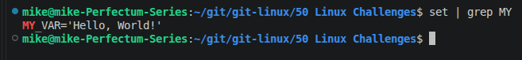

- Запустите новый экземпляр bash (`bash`) и проверьте, доступна ли в нем эта переменная.

`В новом экземпляре bash переменная MY_VAR не будет доступна, т.к. с новым терминалом запускается новый процесс. Чтобы сделать данную переменную доступной во всех терминалах bash, необходимо добавить ее в файл ~/.bashrc`

---

### Задание 10. Псевдонимы (alias):

- Создайте псевдоним `ll` для команды `ls -alF`:

```
alias ll="ls -alF"
```
- Сделайте этот псевдоним постоянным, добавив его в ваш файл ~/.bashrc:

`В файле ~/.bashrc редактировать поле:`
```
# some more ls aliases
alias ll='ls -laF'
#alias la='ls -A'
#alias l='ls -CF'
```
- Перечитайте конфигурацию и проверьте работу псевдонима:

```
bash
ll
```
---

## Раздел 2: Текстовые редакторы и работа с содержимым файлов (Задания 11-18)

### Задание 11. Nano:

- Используя редактор nano, создайте файл notes.txt:

```
nano notes.txt
```
- Включите в нем нумерацию строк (на время сессии):

```
Alt+Shift+#
```
- Напишите в нем 5 строк текста. 
- Найдите слово "текст" и замените его на "слово": 

```
^\
текст
слово
A		# Заменить везде
```
- Сохраните файл и выйдите:

```
^O
^X
```
---

### Задание 12. Vim (базовые операции):

- Откройте файл `/etc/passwd` в редакторе `vim` (только для чтения). 

`Readonly-режим доступен при открытии файла`

- Переместитесь в конец файла, затем в начало:

```
G
1G
```
- Скопируйте строку, содержащую ваше имя пользователя, и вставьте её в конец файла (не сохраняйте изменения):

```
yy
P
```
- Выйдите из vim без сохранения:

```
:q!
```
---

### Задание 13. Vim (поиск и замена):

- Создайте файл text.txt в vim:

```
vim text.txt
```
- Вставьте в него несколько строк с повторяющимися словами, например: `apple banana apple orange banana apple`.
- Используя команду поиска и замены (`:%s`), замените все вхождения слова "apple" на "grape":

```
:%s/apple/grape
```
- Сохраните изменения.

```
wq
```
---

### Задание 14. Команда grep:

- Выведите из файла `/var/log/syslog` (или `/var/log/messages`) все строки, содержащие ошибки (`error`), игнорируя регистр: 

```
grep -i /var/log/syslog
```
- Пронумеруйте эти строки:

```
grep -in /var/log/syslog
```
- Сохраните результат в файл `errors.log`:

```
grep -in /var/log/syslog > errors.log
```
---

### Задание 15. Регулярные выражения (grep): 

- В файле `emails.txt` (создайте его с 5-ю примерами email-адресов и обычного текста) найдите все строки, которые содержат валидный email-адрес. Используйте регулярное выражение:

```
grep -E '^[0-9a-zA-Z_-]*@([a-zA-Z].)*[a-zA-Z]' email.txt
```
---

### Задание 16. Команды head и tail:

- Выведите первые 5 строк файла `/etc/passwd`:

```
head -n 5 /etc/passwd
```
- Выведите последние 5 строк этого же файла:

```
tail -n 5 /etc/passwd
```
- Отслеживайте в реальном времени добавление новых строк в системный лог (например, `journalctl -f` или `tail -f /var/log/syslog`) в течение минуты, затем завершите просмотр.
---

### Задание 17. Сортировка и уникализация:

- Создайте файл `numbers.txt` со случайными числами (по одному на строку)
- Отсортируйте их по числовому значению:

```
sort -n numbers.txt
```
- Удалите дубликаты и подсчитайте количество уникальных чисел.

```
sort -n numbers.txt | uniq | wc -l
```
---

### Задание 18. `sed` (потоковый редактор):

- Создайте файл [config.conf](config.conf) с несколькими строками, содержащими параметры, например, `max_users=10`, `port=8080`.
- Используя команду `sed`, замените значение порта на `9090` и сохраните изменения непосредственно в файле (ключ `-i`):

```
sed -i 's/8080/9090/g' config,conf
```
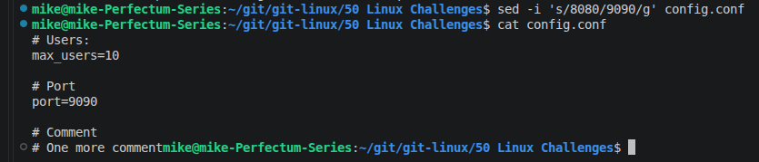
- Удалите из файла все строки, начинающиеся с символа `#`.

```
sed -e '/^#/d' config.conf 
```
---

## Раздел 3: Управление пользователями и правами (Задания 19-26)

### Задание 19. Создание пользователя:

- Создайте нового пользователя `testuser` с домашней директорией `/home/testuser` и оболочкой `/bin/bash`:

```
sudo adduser testuser
```
- Задайте ему пароль:

```
sudo passwd testuser
```
---

### Задание 20. Информация о пользователе: 

- Выведите информацию о созданном пользователе из файлов `/etc/passwd` и `/etc/shadow`. Посмотрите его UID и GID. Определите, в каких группах он состоит:

```
cat /etc/passwd | grep testuser
cat /etc/shadow | grep testuser
id testuser
```
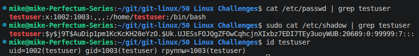

---

### Задание 21. Группы:

- Создайте новую группу `developers`:

```
sudo groupadd developers
```
- Добавьте пользователя `testuser` в эту группу:

```
sudo usermod testuser -aG developers 
```
- Создайте еще одного пользователя `devuser` и также добавьте его в группу `developers`:

```
sudo adduser devuser
sudo usermod devuser -aG developers
```
---

### Задание 22. Права и группы:

- От имени пользователя `testuser` создайте файл `project.txt` в его домашней директории:

```
su - testuser       # su с минусом, чтобы сменить не только пользователя, но и его окружение (в т.ч. директорию, в которой он находится)

touch project.txt
ls -l project.txt
```
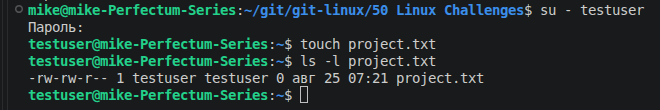

- Измените группу-владельца этого файла на `developers`:

```
chgrp developers project.txt
ls -l
```
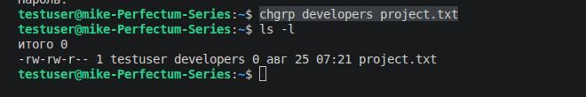

- Установите права `-rw-rw----`, чтобы только пользователь и члены группы могли читать и изменять файл:

```
chmod o-r project.txt
ls -l
exit
```
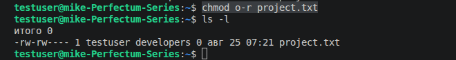

---

### Задание 23. Настройка sudo:

- Настройте права `sudo` так, чтобы пользователь `devuser` мог выполнять команды `apt update` и `apt upgrade` (или `dnf` для CentOS/RHEL) от имени суперпользователя без ввода пароля. Проверьте работу:

```
sudo visudo

# Добавить строку:
devuser ALL=(ALL:ALL) /usr/bin/apt, /usr/bin/su

# /usr/bin/su - чтобы devuser мог выполнять команды от имени суперпользователя без ввода пароля

sudo apt update
# или
sudo su -c "apt update"
```
---

### Задание 24. Блокировка и разблокировка:

- Заблокируйте учетную запись пользователя `testuser` с помощью `usermod -L` (или `passwd -l`). Убедитесь, что войти под ним невозможно. Затем разблокируйте его (`usermod -U`):

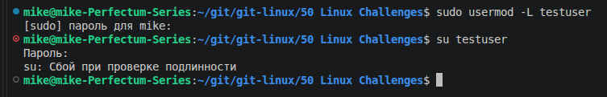


---

### Задание 25. SUID бит:

- Создайте простой скрипт [check_user.sh](check_user.sh), который выводит имя текущего пользователя (`whoami`).

```
chmod +x check_user.sh
```
- Попробуйте установить на него SUID бит. Объясните, почему это не сработает так, как ожидалось, и в чем разница с бинарными файлами:

```
chmod 4775 check_user.sh 
```
`SUID не работает со скриптами. Только с бинарными файлами`

---

### Задание 26. Sticky Bit:
- Создайте общедоступную директорию `/tmp/shared`:

```
mkdir /tmp/shared
```
- Установите на нее права `1777`:

```
chmod 1777 /tmp/shared
```
- Создайте в ней файл от имени `testuser` и попробуйте удалить его от имени `devuser`. Объясните результат:

```
su testuser
touch /tmp/shared/test.txt
su devuser
rm /tmp/shared/test.txt 
```
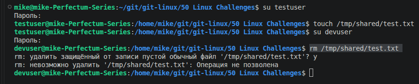

`Sticky-bit защищает файл от удаления. Удалить файл может только его владелец или владелец директории, в которой этот файл находится.`

---

## Раздел 4: Процессы и управление ими (Задания 27-33)

### Задание 27. Просмотр процессов:

- Выполните команду `sleep 300` в фоновом режиме:

```
sleep 300 &
```
- Найдите его PID с помощью `ps`, `pgrep` или `pidof`. Завершите этот процесс:

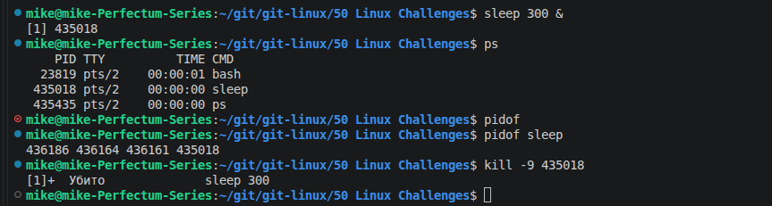

---

### Задание 28. Сигналы:

- Запустите команду `ping ya.ru`
- Найдите её PID:

```
 # В новом терминале:
 ps
```
- Отправьте процессу сигнал `SIGTSTP` (Ctrl+Z) и переведите его в фоновый режим:

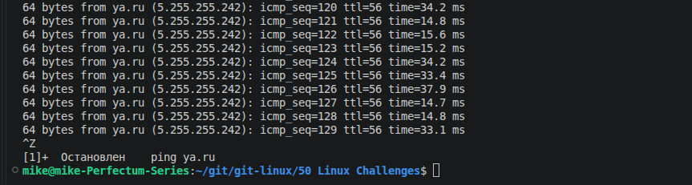

- Посмотрите на список фоновых задач командой `jobs`:

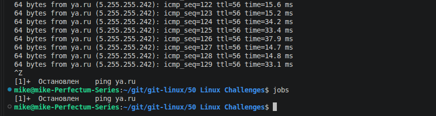

- Затем отправьте ему сигнал `SIGCONT` для возобновления, а затем `SIGTERM` для завершения:

```
# Просмотр кодов сигналов:
kill -l

# Возобновить остановленный процесс:
kill -s SIGCONT <PID>

# Завершить процесс:
kill -s SIGTERM <PID>
```
---

### Задание 29. Приоритеты (nice):

- Запустите ресурсоемкий процесс (например, `dd if=/dev/zero of=/dev/null &`). 
- Запустите этот же процесс, но с более высоким приоритетом (значение nice = -10):

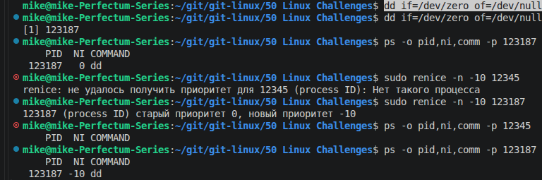

- Сравните значение `NI` и `PR` в выводе `top` для этих двух процессов.

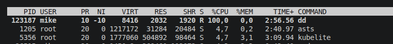
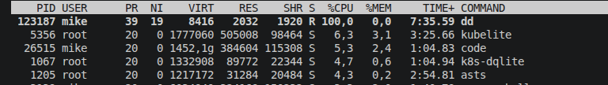

---

### Задание 30. Top и Htop:

- Запустите `top` и отсортируйте процессы по использованию памяти (`Shift+M`).
- Какое приложение потребляет больше всего памяти? 

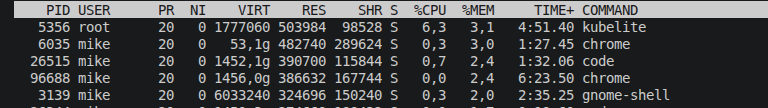

- Затем запустите `htop` и посмотрите на дерево процессов (`F5`). Найдите родительский процесс вашей оболочки.

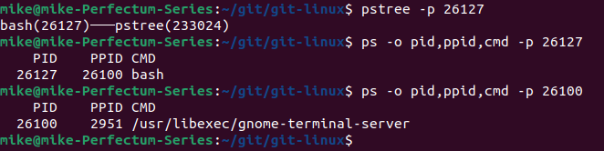

---

### Задание 31. Фоновые и интерактивные процессы: 

- Запустите команду `tar -czf archive.tar.gz /usr/share/doc` в фоновом режиме (`&`). Затем, не дожидаясь её завершения, запустите `ls -la`
- Используйте `jobs` для просмотра статуса задачи:
- Верните tar на передний план с помощью `fg`

---

### Задание 32. Демоны:

- Найдите все запущенные процессы `sshd`:

```
pgrep sshd
```
- Посмотрите, какой PID у главного процесса и какие у него дочерние процессы.
- Какой родительский процесс у sshd?

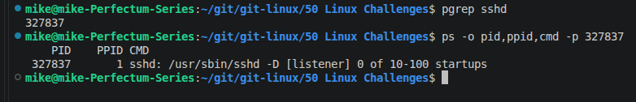

---

### Задание 33. Анализ системных вызовов:

- Используйте `strace` для отслеживания системных вызовов, которые делает команда `ls -l`

```
strace -c ls -l > strace.txt
```
- Перенаправьте вывод `strace` в файл для анализа. Обратите внимание на системные вызовы `open`, `read`, `write`.

---

## Раздел 5: Управление пакетами (Задания 34-37)

### Задание 34. Поиск пакета:

- Найдите в репозиториях пакет для установки веб-сервера nginx:

```
apt search nginx
```
- Узнайте информацию о нём: версию, описание, зависимости:

```
apt show -a nginx
```
---

### Задание 35. Установка и удаление: 

- Установите пакет `mc` (Midnight Commander):

```
sudo apt install mc
```
- После установки запустите его и ознакомьтесь с интерфейсом. Затем удалите этот пакет, но сохраните его конфигурационные файлы:

```
sudo apt remove mc
```
- После этого полностью удалите его (`purge`) и освободите неиспользуемые зависимости.

```
sudo apt purge mc
sudo apt autoremove
```
---

### Задание 36. Работа с dpkg: 
- Скачайте какой-нибудь `.deb` пакет из интернета (например, `google-chrome-stable`):

```
wget https://google-chrome-stable
```
- Просмотрите список файлов, которые будут установлены с этим пакетом, не устанавливая его (`dpkg --contents`):

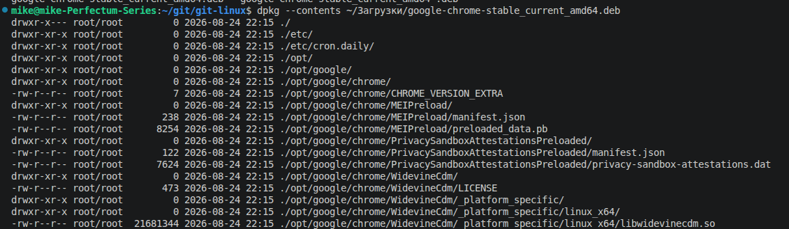

- Затем установите его с помощью `dpkg -i`. Объясните, что будет, если у пакета есть неудовлетворенные зависимости.

`Без необходимых зависимостей пакет не установится или не запустится`

---

### Задание 37. Сборка из исходников (теоретическое): 
- Опишите пошаговый процесс установки программы из исходных кодов, используя команды ./configure, make, make install. Объясните назначение каждого шага.

---

## Раздел 6: Файловые системы, диски и LVM (Задания 38-44)

### Задание 38. Информация о дисках:

- Выведите список всех блочных устройств в системе с информацией об их размерах и точках монтирования (`lsblk`): 

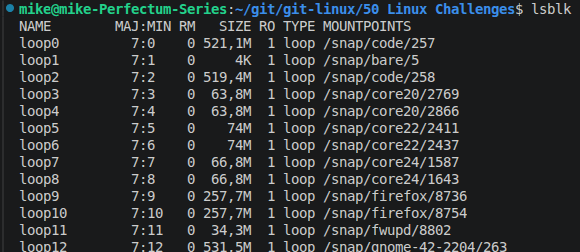

- Посмотрите, какие файловые системы используются на ваших разделах (`df -Th`).

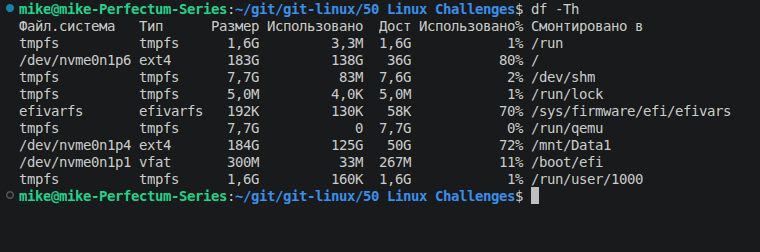

---

### Задание 39. Монтирование (виртуальное): 

- Создайте файл размером 100 МБ (`dd if=/dev/zero of=disk.img bs=1M count=100`):

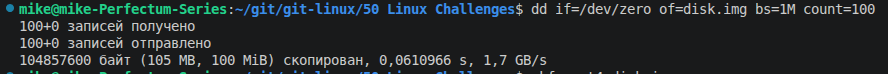

- Создайте на этом файле файловую систему `ext4` (`mkfs.ext4 disk.img`):

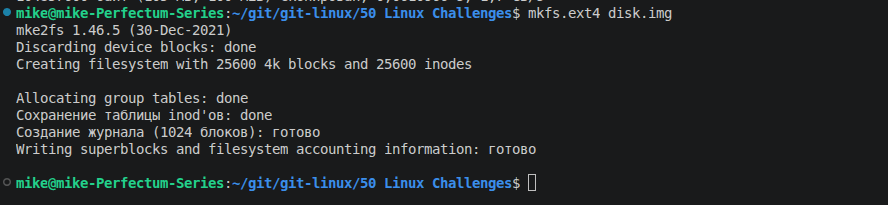

- Создайте директорию `/mnt/test_disk`:

```
sudo mkdir /mnt/test_disk
```
- Примонтируйте созданный образ диска в эту точку монтирования:

```
sudo mount ./disk.img /mnt/test_disk/
```
- Запишите в него несколько файлов и отмонтируйте:

```
sudo touch /mnt/test_disk/file1 /mnt/test_disk/file2 /mnt/test_disk/file3
ls /mnt/test_disk/
sudo umount /mnt/test_disk 
```
---

### Задание 40. Fstab:

- Добавьте ваш виртуальный диск из предыдущего задания в `/etc/fstab` для автоматического монтирования при загрузке. Используйте его UUID.

```
/home/mike/disk.img /mnt/test_disk ext4 loop,defaults 0 0
```
- Проверьте, что конфигурация корректна с помощью `findmnt --verify`.

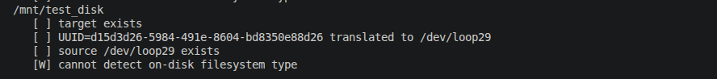

---

### Задание 41. Swap:

- Создайте swap-файл размером 512 МБ в корневой директории:

```
sudo fallocate -l 512MB /swapfile
```
- Активируйте его и проверьте, что он появился в выводе `swapon --show`:

```
chmod 600 /swapfile
sudo swapon /swapfile
```
- Добавьте его в `/etc/fstab` для постоянного использования:

```
echo '/swapfile none swap sw 0 0' | tee -a /etc/fstab
```
---

### Задание 42. LVM (теория/практика):

- Опишите разницу между физическими томами (PV), группами томов (VG) и логическими томами (LV):

`Физический том (PV) — это непосредственно устройство хранения (жесткий диск, SSD, раздел или даже файл-образ), которое LVM подготавливает для использования`

`Группа томов (VG) - это пул (хранилище) из одного или нескольких физических томов. Это абстрактный контейнер, который объединяет дисковое пространство из разных PV в единый ресурс`

`Логический том (LV) - это виртуальный раздел, который создается внутри группы томов (VG). Именно его видит операционная система и именно с ним работают пользователи`
- В чем преимущества LVM перед обычными разделами?

`Если есть 2 раздела, идущих один за другим, то нельзя увеличить первый раздел, не уничтожив второй стандартными методами, а с помощью LVM можно.`

- Cоздайте PV, VG и LV на вашем виртуальном диске из задания 39


