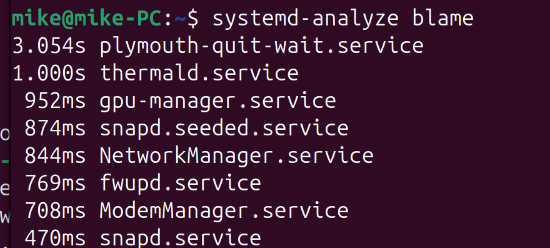
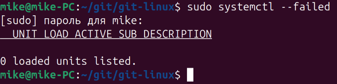

# Домашнее задание к занятию "Инициализация системы. Systemd, init-v"

### Цель задания

В результате выполнения этого задания вы:

* закрепите свои знания о порядке загрузки операционной системы.
* научитесь определять службы, которые не запустились.

---

### Задание 1

Выполните `systemd-analyze blame`. Эта команда покажет сколько времени было потрачено на загрузку того или иного сервиса.

*Укажите, какие модули загружаются дольше всего.*



### Задание 2

Какой командой вы посмотрите ошибки ядра, произошедшие начиная со вчерашнего дня?
```
journalctl -k -p 3 --since=2026-10-30
```

### Задание 3

Запустите команду `loginctl user-status`.

*Напишите, что выполняет и для чего предназначена эта утилита.*
```
Программа loginctl дает право пользователю управлять всем, что имеет отношение к авторизации пользователей.
user-status  – аналогично session-status, выводит дату авторизации, состояние и все запущенные процессы в виде дерева.
```

### Задание 4

Есть ли у вас на машине службы, которые не смогли запуститься? Как вы это определили?
```
sudo systemctl --failed
```

**Примечание:** обычно все сервисы запускаются и всё работает хорошо, но вы можете смоделировать ситуацию когда не все сервисы запускаются, для этого вы можете установить сервер JX и сломать его конфигурационный файл, просто удалив оттуда случайную строчку с фигурной скобкой.



### Задание 5

Можно ли с помощью systemd отмонтировать раздел или устройство?
```
Полагаю, что можно. 
Необходимо создать сервис запускающий скрипт монтирующий устройство. Данный сервис нужно привязать к дефолтному таргету загрузки.
```