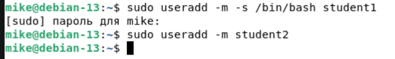
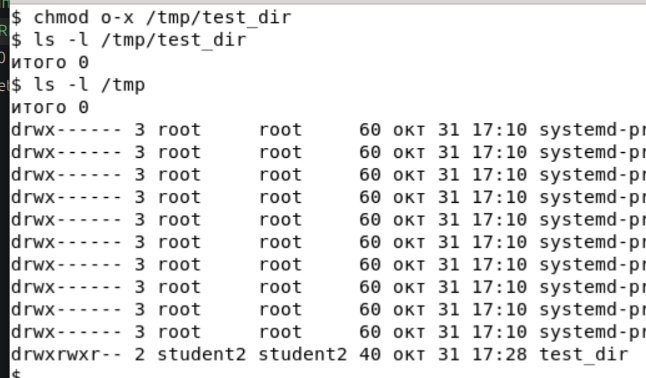
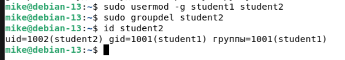

# Домашнее задание к занятию «Управление пользователями»

### Цель задания
В результате выполнения этого задания вы:

* закрепите свои знания об управлении пользователями;
* научитесь управлять группами правами доступа к каталогам;
* поймёте, зачем пользователи и пароли разбиты на два отдельных файла.

----

### Задание 1

1. Создайте пользователя `student1` с оболочкой bash, входящего в группу `student1`.
```
sudo useradd -m -s /bin/bash student1
```

2. Создайте пользователя `student2`, входящего в группу `student2`.
```
sudo useradd -m student2
```


### Задание 2

Создайте в общем каталоге (например, /tmp) директорию и назначьте для неё полный доступ со стороны группы `student2` и доступ на чтение всем остальным.
```
# Задать пароль пользователю student2:
sudo passwd student2

# Зайти под пользователем student2:
su student2

# Создать директорию:
mkdir /tmp/test_dir

# Ограничить остальных пользователей чтением данной директории:
chmod o-x /tmp/test_dir
```


### Задание 3

Какой режим доступа установлен для файлов `/etc/passwd` и `/etc/shadow`?

Объясните, зачем понадобилось именно два файла.
```
Для файла /etc/passwd установлены следующие права доступа: для пользователя root - чтение/запись; для группы root и всех остальных - чтение.
Для файла /etc/shadow для пользователя root - чтение/запись; для группы shadow - чтение; для остальных пользователей прав нет.
Два файла созданы в целях безопасности. Файл shadow содержит захэшированные пароли и недоступен для просмотра и редактирования сторонним пользователям.
Файл passwd содержит данные о пользователях системы и может редактироваться пользователем с правами root.
```


### Задание 4

Удалите группу `student2`, а пользователя `student2` добавьте в группу `student1`.
```
# Сделать основной группой пользователя student2 группу student1:
sudo usermod -g student1 student2

# Удалить группу student2:
sudo groupdel student2

# Просмотр групп пользователя student2:
id student2
```


### Задание 5

Напишите своими словами, как происходит сложение и вычитание прав доступа к файлам и папкам.
```
Если речь идет о назначении прав доступа по умолчанию, то здесь работает такой инструмент, как umask.
По умолчанию маска задается 022. 
Данная маска накладывается на права для файлов со значением 666 (666 - 022 = 644). Таким образом файлы создаются с правами доступа: -rw-r–r–.

Для директорий значение маски вычитается из значения 777 (777 - 022 = 755). Таким образом создается директория с правами доступа по умолчанию: drwxr-xr-x
```

---

### Задание 6*

Создайте в общем каталоге (например, /tmp) директорию и назначьте для неё полный доступ для всех, кроме группы `student1`.  Группа `student1` не должна иметь доступа к содержимому этого каталога.
```
# Создать пользователя test_user, сделав его основной группой группу student1:
sudo useradd -m -g student1 test_user

# Переключиться на данного пользователя:
su test_user

# Создать директорию:
mkdir /tmp/test_dir2

# Сменить пользователя:
exit

# Изменить права на папку:
sudo chmod 707 /tmp/test_dir2
```