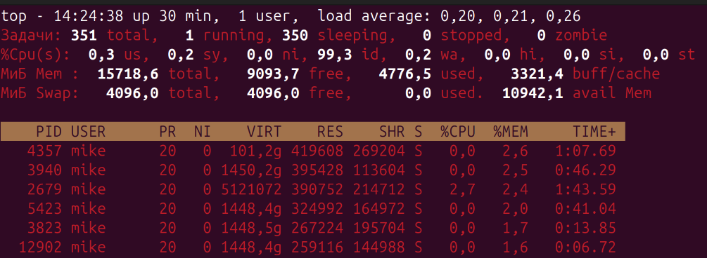
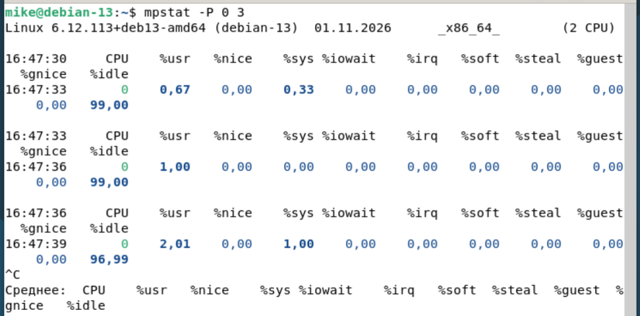
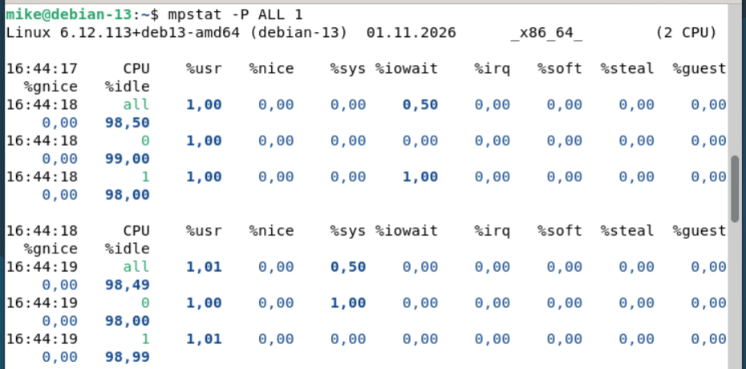
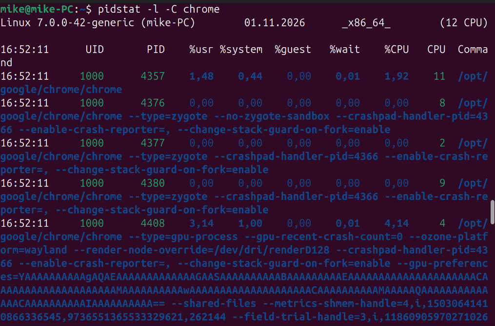
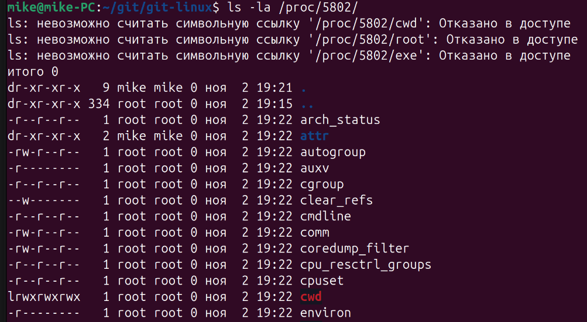

# Домашнее задание к занятию «Производительность системы. Часть 1»

------

### Задание 1

Выполните проверку системы при помощи команды `top`.

**Выведите сортировку процессов по:**

- памяти,
```
Shift+M
```

- времени работы,
```
Shift+T
```
- номеру,
```
Shift+N
```
- уровню потребления ресурсов.
```
top -n 3
```

### Задание 2

Выполните проверку системы при помощи команды `atop` и `atopsar`.

**Выведите сортировку процессов по:**

- общей нагрузке — минимум по трём параметрам;
```
# В интерактивном режиме сортировка по нагрузке на процессор:
С
# В интерактивном режиме сортировка по нагрузке на память:
M
# В интерактивном режиме сортировка по нагрузке на диск:
D
# Или запуск команды с параметрами:
atop -c
atop -m
atop -d
```
- загруженности HDD or SSD за указанный временной отрезок — 10 минут;
```
atopsar -d -b 14:00 -e 14:10

# -d - диск
# -b - begin
# -e - end 
```
- загруженности RAM за указанный временной отрезок — 10 минут.
```
atopsar -m -b 14:00 -e 14:10
```

**Сконфигурировать файл настроек atop — делать снимок памяти каждые полчаса.**
```
# Конфигурация в файле /etc/default/atop:
LOGINTERVAL=1800 - время среза в секундах
LOGGENERATION=28 - за сколько дней храним данные
```
------

### Задание 3

При помощи команды `mpstat` и ключа `P` выведите информацию по:

- нулевому процессору, каждые 3 секунды:
```
mpstat -P 0 3
```

- всем процессорам
```
# Статистика по всем ядрам каждую секунду:
mpstat -P ALL 1
```


------

### Задание 4.

Выполните проверку системы при помощи команды `pidstat`.

1. Выведите статистику по эффективности на основе имени процесса.
```
pidstat C chrome
```
2. Выведите полный путь процесса.
```
pidstat -l -C chrome
```


---

### Задание 5*

Просмотрите каталог `/proc`, выполните любую команду для просмотра процессов.
Сделайте сравнение вывода команды и содержания папки по:
- взаимосвязи объектов,
- времени создания.

**Этапы выполнения**:

1. Создайте два окна терминала (вкладку или терминала CLI через комбинацию cntrl+alt+f'x'); 
 
2. На одном запустите любое приложение (команду) в активное использование или в фон при помощь связки & (например, `ping 127.0.0.1 &`); 

3. Определите pid процесса;

4. Просмотрите каталог /proc и найдите папку с номером pid процесса;  

5. Просмотрите директории при помощи `ls -la`;


  
6. Просмотрите внутреннее устройство директории; 

7. Ответьте на вопрос, какую информацию содержит: 
  
cmdline - содержит запущенную команду(ping 127.0.0.1)
cwd - ссылка на текущую рабочую директорию
environ - файл содержащий список переменных окружения
exe - ссылка на исполняемый файл команды
fd - список файловых дескрипторов
maps - информация о выделенных участках памяти процесса
root - ссылка на корневую директорию
status - подробная информация о процессе