# Pet-проект "Основы Linux"

**Цель проекта:** Развернуть и настроить небольшую инфраструктуру для веб-приложения, используя все основные инструменты и концепции Linux.

**Архитектура:**

- **ВМ "Server" (серверная часть):** Ubuntu Server (без графического интерфейса). На ней будет работать веб-приложение и база данных.

- **ВМ "Client" (клиентская часть):** Ubuntu Desktop (с графическим интерфейсом). С нее вы будете управлять сервером, тестировать сетевые настройки и работать с приложениями.

---

## Этап 1. Развертывание и базовая настройка ВМ

Этот этап посвящен первоначальной настройке виртуальных машин.

№ | Задание | Пункт из "Содержания"
:--- |:-----:| -------:
1.1 | На «Client» ВМ создайте нового пользователя `devops` с правами администратора. Установите для него пароль.		 |	23.4. Useradd, Usermod, Userdel
1.2 |	На обеих ВМ настройте часовой пояс и синхронизацию времени.		 |	3. Запуск программ в терминале (timedatectl)
1.3 | На обеих ВМ измените имя хоста на осмысленное (например, `server-vm` и `client-vm`). | 9. Информация о системе (hostnamectl)
1.4	| На «Server» ВМ создайте двух новых пользователей: `appuser` (для запуска приложения) и `dbuser` (для управления БД). Они не должны иметь возможность входа в систему через SSH. |	23.1. /etc/passwd и /etc/shadow (создание пользователей с оболочкой /sbin/nologin)
1.5	| На «Server» ВМ настройте политику паролей: для пользователя appuser установите максимальный срок действия пароля 30 дней и минимальный 7 дней. | 23.2. Настройка пароля chage

---

**Решение:**

1.1.
```
# Создание пользователя:
sudo useradd -m -s /bin/bash -G sudo devops

# Задание пароля для пользователя:
sudo passwd devops

```
1.2.
```
# Список временных зон:
timedatectl list-timezones

# Задание временной зоны:
sudo timedatectl set-timezone Europe/Moscow

# Просмотр текущих настроек:
timedatectl
```
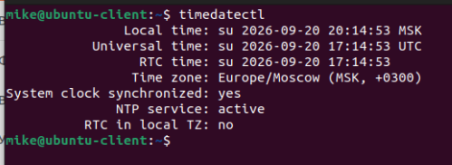

1.3.
```
# Переименование клиентской машины:
sudo hostnamectl set-hostname client-vm

# Переименование серверной машины:
sudo hostnamectl set-hostname server-vm
```
После перезапуска терминальных сессий просмотр результата:
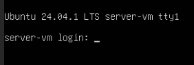 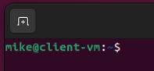

1.4.
```
# Добавление 2-х новых пользователей:
useradd -s /sbin/nologin appuser
useradd -s /sbin/nologin dbuser

# Просмотр списка пользователей:
cat /etc/passwd
```
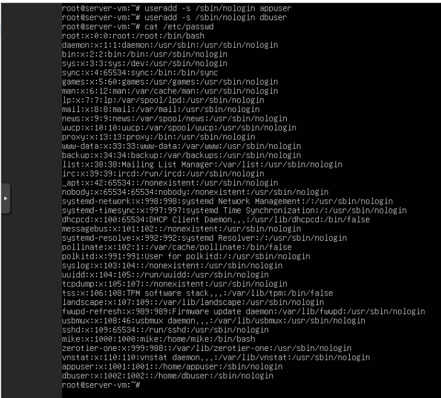

1.5.
```
# Создание пароля для пользователя appuser:
passwd appuser

# Задание политики пароля:
chage -M 30 -m 7 appuser

# Просмотр политик пароля:
chage -l appuser
```
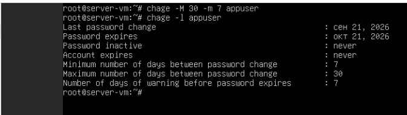

---

## Этап 2. Базовое администрирование и знакомство с системой

Вы познакомитесь с работой в терминале, управлением файлами, процессами и правами.

№ | Задание | Пункт из "Содержания"
:--- |:-----:| -------:
2.1 | Используйте псевдонимы (`alias`), чтобы сделать работу в терминале удобнее. Например, создайте псевдоним `ll` для `ls -alF` и `gs` для `git status`. | 8. Alias
2.2 | На «Client» ВМ создайте переменную окружения PROJECT_DIR со значением пути к рабочей директории проекта (~/projects/lab). Сделайте эту переменную постоянной. | 7. Переменные
2.3 | На «Client» ВМ в домашней директории создайте иерархию каталогов: `projects/lab/{app,db,logs,backup}`. | 10. Пути и директории
2.4 | В директории `app` создайте файлы `app.py` и `README.md`. В `db` создайте файл `schema.sql`. Используйте `touch`. | 11. Создание и копирование файлов
2.5 | Настройте права доступа: для директории `logs` установите права `drwxrwxr-x` (775). Для файла `app.py` установите права `-rwxr-xr--`.
2.6 | Используя `stat`, получите подробную информацию о файле `app.py`. | 11. Создание и копирование файлов (stat)
2.7 | На «Server» ВМ создайте системную группу `webteam`. Добавьте в нее пользователя `appuser`. | 23.6. Groups
2.8 | На «Server» ВМ установите `umask` для пользователя `appuser` так, чтобы все создаваемые им файлы имели права `-rw-rw----` (660), а директории `drwxrwx---` (770). | 27. Umask
2.9 | На «Server» ВМ создайте файл `/tmp/shared/testfile` и настройте права доступа с помощью ACL так, чтобы пользователь `dbuser` имел право на чтение, а пользователь `appuser` — на чтение и запись. | 28. ACL
2.10 | На «Client» ВМ создайте скрытый файл `.env` в директории `projects/lab`. | 11. Создание и копирование файлов (скрытые файлы)
2.11 | На «Server» ВМ создайте символическую ссылку `app` на директорию `/opt/app/current` (создайте её). | 12. Перемещение, переименование, удаление. Жесткие и символические ссылки
2.12 | На «Client» ВМ проверьте тип файлов в директории `projects/lab` с помощью `file`.

---

**Решение:**

2.1
```
# Создание алиасов:
alias ll='ls -alF'
alias gs='git status'

# Просмотр всех алиасов:
alias
```
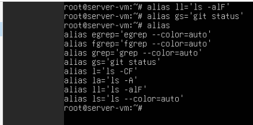

2.2
```
# Чтобы сделать переменную PROJECT_DIR постоянной, в конце файла ~/.bashrc нужно добаить строку:
export PROJECT_DIR="$HOME/projects/lab"

# Применить изменения в текущей сессии:
source ~/.bashrc

# Перезапустить терминал и убедиться, что переменная сохранилась:
echo $PROJECT_DIR
```
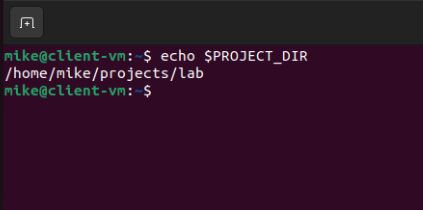

2.3
```
# Создание каталогов:
mkdir projects/lab/{app,db,logs,backup}
```


2.4
```
# Создание файлов:
touch projects/lab/app/app.py
touch projects/lab/app/README.md
touch projects/lab/db/schema.sql

# Просмотр содержимого директорий:
ls projects/lab/app projects/lab/db
```
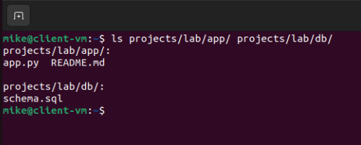

2.5 
```
# Настройка прав доступа для директории:
chmod 775 projects/lab/logs

# Настройка прав доступа для файла:
chmod 754 projects/lab/app/app.py
```
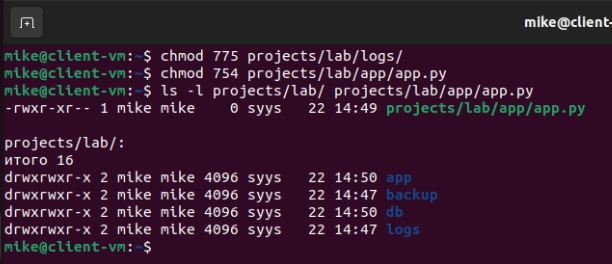

2.6
```
Подробная информация о файле:
stat projects/lab/app/app.py
```
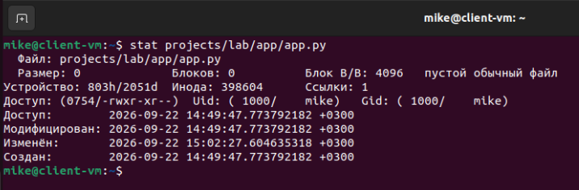

2.7
```
# Создание группы:
addgroup webteam

# Добавление пользователя в группу:
usermod -aG webteam appuser

# Просмотр списка групп пользователя:
groups appuser
```
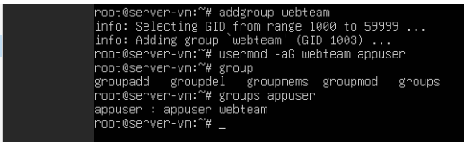

2.8
```
# Создать скрипт /etc/profile.d/umask-appuser.sh для задания umask пользователю appuser:

#!/bin/bash

if [ "$(id -un)" = "appuser" ]; then
    umask 007
fi

# Сделать скрипт исполняемым:
sudo chmod +x /etc/profile.d/umask-appuser.sh
```
2.9
```
# Установить ACL:
apt install acl

# Временно назначить рабочие shells пользователям:
usermod -s /bin/bash appuser
usermod -s /bin/bash dbuser

# Задать права на файл:
setfacl -m u:dbuser:r /tmp/shared/testfile
setfacl -m u:appuser:rw /tmp/shared/testfile

# Проверить манипуляции с файлом под каждым пользователем и вернуть им /sbin/nologin
```
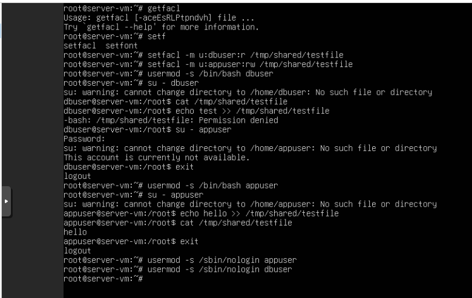

2.10
```
# Создать скрытый файл .env:
touch projects/lab/.env

# Просмотр содержимого директории:
ls -a projects/lab
```
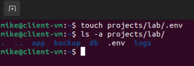

2.11 На «Server» ВМ создайте символическую ссылку app на директорию /opt/app/current (создайте её).
```
# Создать вложенную директорию:
mkdir -p /opt/app/current

# Создать символьную ссылку на директорию:
ln -s /opt/app/current sym_link
```
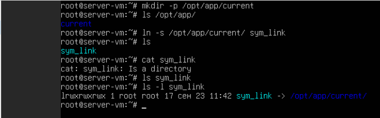

2.12
```
# Проверка типов файлов:
file prjects/lab/*
```
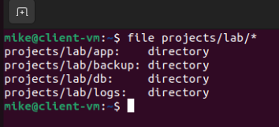

---

## Этап 3. Управление ПО и пакетами

Вы научитесь искать, устанавливать и удалять программы, а также собирать ПО из исходных кодов.

№ | Задание | Пункт из "Содержания"
:--- |:-----:| -------:
3.1	| На «Client» ВМ обновите списки пакетов и установите менеджер пакетов `synaptic` и `htop`.	| 20.1. Средство управление пакетами - Apt
3.2 | На «Client» ВМ установите `nginx` из официального репозитория. Затем полностью удалите его вместе со всеми конфигурационными файлами. | 20.1. Средство управление пакетами - Apt
3.3	| На «Server» ВМ скачайте и установите пакет `mc` (Midnight Commander) через `apt`.	| 20.1. Средство управление пакетами - Apt
3.4	| На «Server» ВМ установите `python3-pip`. С помощью `pip` установите пакет `flask` в виртуальное окружение `my_venv`.	| 20.8. Прочие пакетные менеджеры
3.5	| На «Server» ВМ скачайте исходный код утилиты `tmux` с официального сайта (или GitHub). Соберите и установите её в директорию `/opt/tmux/`. | 20.3. Компиляция пакетов из исходников
3.6	| На «Server» ВМ установите snap-пакет `hello-world`.	| 20.2. Snap

**Решение:**

3.1
```
# Обновление списка пакетов:
sudo apt update

# Установка программ:
sudo apt install synaptic htop
```
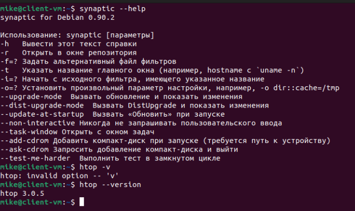

3.2
```
# Установка Nginx:
sudo apt install nginx

# Удаление программы, конфигураций и зависимостей:
sudo apt autopurge nginx
```
3.3
```
apt update
apt install mc
```
3.4
```
# Скачать пакет для создания виртуальной среды:
apt install python3.12-venv

# Создание виртуальной среды:
python3 -m venv my_venv

# Добавить это окружение в переменные окружения: 
source my_venv/bin/activate

# Обновить менеджер pip:
pip install --upgrade pip

# Установка flask:
pip install flask

# Выйти из окружения:
deactivate
```
3.5
```
# Установить компиляторы:
apt install build-essential autoconf automake

# Скачать с github архив с исходниками:
wget https://github.com/.../tmux-3.5a.tar.gz

# Распаковать архив и перейти в папку с файлами:
tar xf tmux-3.5a.tar.gz

# Установить необходимые зависимости (указаны в README):
sudo apt install build-essential libevent-dev libncurses-dev pkg-config yacc

# Создать Makefile:
./configure

# Запустить сборку(компиляцию):
make

# Запустить полученную программу:
./tmux
```
3.6
```
snap install hello-world
```
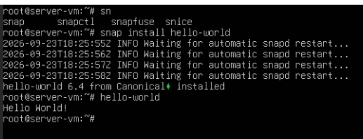

---

## Этап 4. Текстовые редакторы и обработка данных

Вы будете активно работать с текстовыми файлами, используя редакторы и утилиты командной строки.

№ | Задание	| Пункт из "Содержания"
:--- |:-----:| -------:
4.1	| На «Client» ВМ создайте файл `config.ini` с настройками проекта, используя редактор `nano`. Включите в нем нумерацию строк.	| 19.1. Nano
4.2	| На «Client» ВМ отредактируйте файл `config.ini` в редакторе `vim`. Научитесь перемещаться по файлу, удалять и вставлять строки.	| 19.2. Vim
4.3	| Используя команду `sed`, замените все вхождения `localhost` на `0.0.0.0` в файле `config.ini`. Не изменяя сам файл, выведите результат в терминал.	| 19.3. Sed
4.4	| Используя `sed` с ключом `-i`, сделайте замену порта `8080` на `9000` прямо в файле `config.ini`.	| 19.3. Sed
4.5	| На «Client» ВМ сгенерируйте файл `access.log` с несколькими записями (например, для Nginx). Используйте команды `grep`, `awk`, `sort`, `uniq`, `wc` для анализа этого файла.	| 15. Регулярные выражения, 18.7. Sort, Uniq, 18.12. WC
4.6	| Используя `find` и `grep`, найдите в директории `/etc` все файлы, содержащие слово `nginx`.	| 14.1. Find, 14.3. Поиск с помощью whereis, which, type, grep
4.7	| На «Client» ВМ используйте `curl` и `grep` для получения заголовка `Content-Type` с сайта `google.com`. | 53.7. Curl
4.8	| На «Server» ВМ посмотрите 10 последних строк лога `syslog (/var/log/syslog)`. Затем начните отслеживать его в реальном времени. | 18.5. Head и Tail
4.9	| На «Server» ВМ с помощью `journalctl` посмотрите логи службы `ssh` за последние 10 минут.	| 32.1. Работа с журналом

**Решение:**

4.1
```
# Открыть файл в редакторе nano:
nano config.ini

# Содержимое файла:
[app]
name = lab-app
version = 1.0.0
debug = true
host = 0.0.0.0
port = 8080

[database]
host = localhost
port = 5432
name = labdb
user = dbuser
password = secret123

[logging]
level = INFO
file = /var/log/lab-app/app.log
max_size = 10MB

[security]
secret_key = my-super-secret-key
session_timeout = 3600

# Включить нумерацию строк:
Alt+Shift+#
```
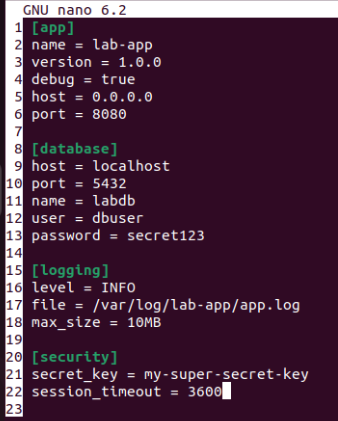

4.3
```
sed 's/localhost/0.0.0.0/' projects/lab/config.ini
```
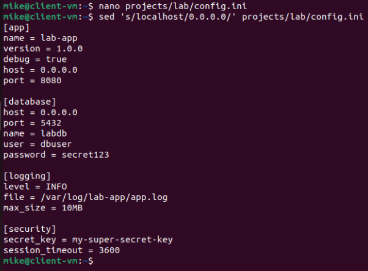

4.4
```
sed -i 's/8080/9000/' projects/lab/config.ini
```
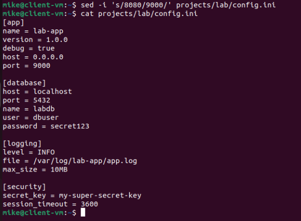

4.6
```
grep -iRl "nginx" /etc
```
4.7
```
curl -I https://google.com | grep -i Content-Type
```
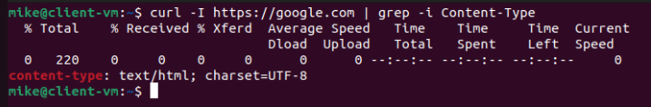

4.8
```
tail /var/var/syslog
```
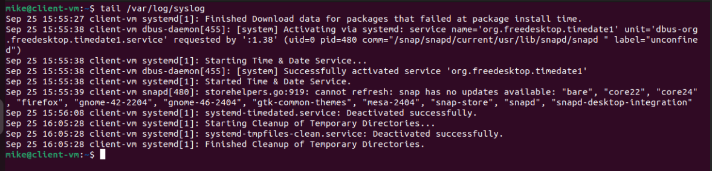

4.9
```
journalctl -u sshd --since 16:00
```
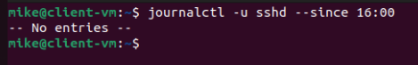

---

## Этап 5. Работа с процессами

Вы научитесь управлять процессами: запускать, останавливать, изменять приоритет и анализировать их работу.

№ | Задание	| Пункт из "Содержания"
:--- |:-----:| -------:
5.1	| На «Client» ВМ запустите процесс `sleep 300` в фоновом режиме. Найдите его PID. Приостановите, а затем возобновите его с помощью сигналов. | 40. Фоновый режим работы процесса, 36. Сигналы
5.2	| На «Client» ВМ запустите команду `dd if=/dev/zero of=/dev/null &`. Измените её приоритет (значение `nice`) на `10` с помощью `renice`. | 39. Приоритеты процессов
5.3	| С помощью `ps` и `pstree` выведите дерево процессов, чтобы увидеть, какая оболочка является родительской для вашего текущего сеанса. | 35. Утилита ps
5.4	| На «Client» ВМ откройте `htop` и найдите процессы, потребляющие больше всего памяти. Отсортируйте их по этому параметру. | 38. Утилита top
5.5	| На «Server» ВМ используйте `strace`, чтобы проследить системные вызовы команды `ls -la /tmp`. Сохраните вывод `strace` в файл. | 33.3. Подсистемы ядра
5.6	| На «Client» ВМ создайте systemd-сервис для скрипта-демона, который раз в 10 секунд пишет в лог "I am working". Запустите и включите сервис. | 31.7. Создание сервиса и программы в рамках этого сервиса, 31.2. Systemd
5.7	| На «Client» ВМ создайте шаблонный сервис (`@.service`) для запуска нескольких экземпляров скрипта, которые пишут в разные логи. | 31.8. Создание шаблона сервиса
5.8	| На «Client» ВМ создайте systemd-таймер, который запускает ваш сервис из шага 5.6 ежедневно в 2 часа ночи.	| 31.3. Работа с таймерами

**Решение:**

5.1
```
# Запустить процесс в фоне:
sleep 300 &

# Вывести из фона:
fg

# Приостановить его:
Ctrl + Z

# Возобновить процесс в фоне:
bg
```
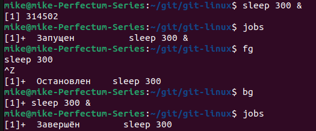

5.2
```
renice 10 2641
top
```
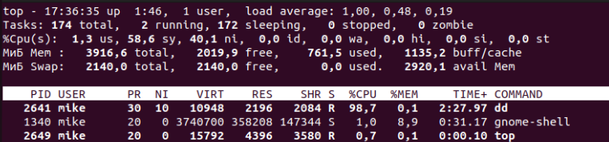

5.3
```
# Запускаю процесс sleep 5000
sleep 5000

# Просмотр дерева процессов:
pstree
```
Процесс sleep находится в ветке:
systemd - gnome-terminal - bash - sleep


5.4

`В утилите htop сортировку можно осуществлять с помощью курсора мыши, кликая по заголовку стлобца длля сортировки. Наиболее ресурсоемкими являются процессы microk8s:` 


5.5
```
# Отслеживание системных вызовов команды и запись их в файл:
strace ls -la /tmp &> ls_sysscalls.txt
```

5.6
```
# Создание скрипта для выполнения:
sudo nano /usr/local/sbin/mysvc

# Содержание скрипта:
#!/usr/bin/env bash

while :; do
	echo I am working
	sleep 10
done

# Задание исполняемости файлу скрипта:
sudo chmod +x /usr/local/sbin/mysvc

# Описание сервиса для скрипта /etc/systemd/system/mysvc.service:
[Unit]
Description=My test service

[Service]
ExecStart=/usr/local/sbin/mysvc

[Install]
WantedBy=multi-user.target

# Запуск сервиса:
sudo systemctl start mysvc.service

# Добавление сервиса в автозагрузку:
sudo systemctl enable mysvc

# Перезагрузка машины:
sudo reboot now

# Проверка работы сервиса:
sudo systemctl status mysvc
```
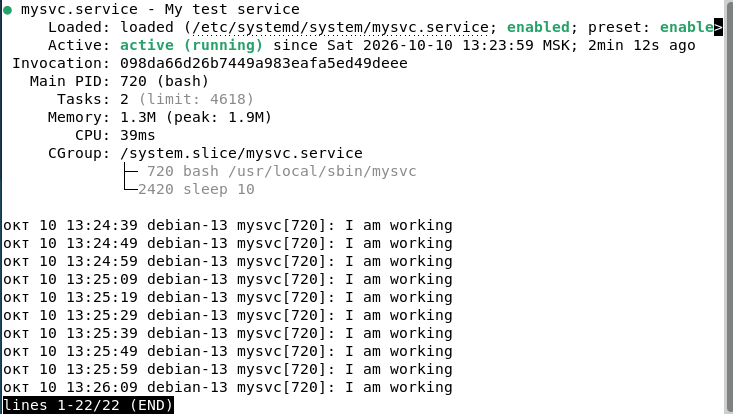

5.7
```
# Содержание измененного скрипта:
#!/usr/bin/env bash

while :; do
	echo I am working > "$1" // Добавление переменной файла, в который будет записываться сообщение
	sleep 10
done

# Создание шаблона /etc/systemd/system/mysvc@.service:
[Unit]
Description=My test service

[Service]
Environment=LOG_FILE=/home/mike/log1.txt
ExecStart=/usr/local/sbin/mysvc ${LOG_FILE}

[Install]
WantedBy=multi-user.target

# Запуск сервиса:
sudo systemctl start mysvc@log1.txt

# Просмотр файла с логами:
cat log1.txt
```
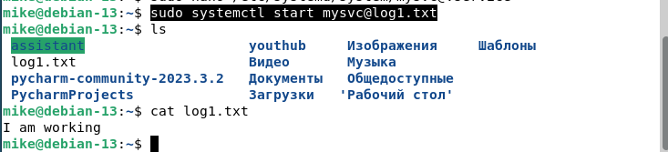

5.8
```
# Создание таймера /etc/systemd/system/mysvc.timer:
[Unit]  
Description=My service timer

[Timer]  
OnCalendar=2:00
AccuracySec=1m
Persistent=true  
Unit=mysvc.service

[Install]  
WantedBy=timers.target

# Запуск таймера:
sudo systemctl start mysvc.timer
```
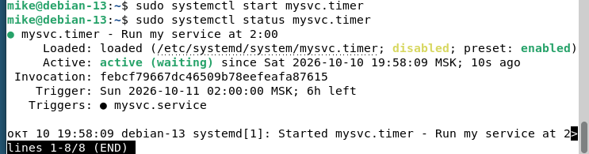

---

## Этап 6. Управление загрузкой и железом

Вы научитесь анализировать информацию о системе, изменять параметры ядра и работать с оборудованием.

№ | Задание	| Пункт из "Содержания"
:--- |:-----:| -------:
6.1	| На «Client» ВМ просмотрите информацию о параметрах ядра, которые были переданы при загрузке. | 30.4. Параметры ядра
6.2	| На «Client» ВМ измените параметр ядра `vm.swappiness` на значение `10` в файле конфигурации, чтобы он сохранялся после перезагрузки. | 34. Память и процессы (sysctl)
6.3	| На «Server» ВМ загрузите модуль ядра для работы с USB-устройствами, затем выгрузите его. | 33.2. Модули ядра (modprobe)
6.4	| На «Client» ВМ просмотрите список всех загруженных модулей ядра. | 33.2. Модули ядра (lsmod)
6.5	| На «Client» ВМ определите, использует ли ваша система BIOS или UEFI. | 30.2. UEFI (efibootmgr)
6.6	| На «Client» ВМ посмотрите логи ядра, относящиеся к предыдущей загрузке. | 33.6. Логи ядра
6.7	| На «Client» ВМ просмотрите информацию о процессоре, используя файлы в /proc. | 45.2. Procfs (/proc) (cat /proc/cpuinfo)
6.8	| На «Client» ВМ используйте `udevadm`, чтобы просмотреть атрибуты сетевого интерфейса `eth0` (или `enp0s3`). | 33.4. Udev

**Решение**

6.1
```
# Текущие параметры ядра:
cat /proc/cmdlin
```
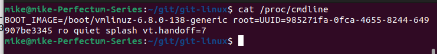

6.2
```
# Просмотр текущего значения swappiness:
cat /proc/sys/vm/swappiness

# Задать новое значение swappiness:
sudo sysctl vm.swappiness=10
```
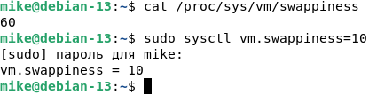
```
# Сохранить значение после перезагрузки (создать /etc/sysctl.d/99-swappiness.conf):
vm.swappiness=10

# Перезагрузить машину и проверить значение:
cat /proc/sys/vm/swappiness
```
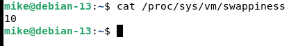

6.3
```
# Загрузить модуль ядра для usb-устройств:
sudo modprobe usb-storage

# Проверка загруженности модуля:
lsmod | grep usb_storage
```
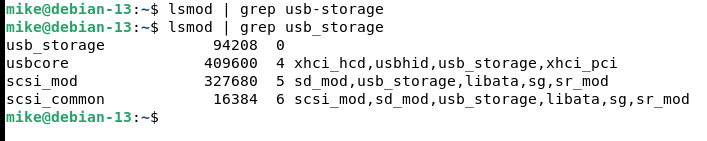
```
# Выгрузка модуля:
sudo modprobe -r usb-storage
```


6.4
```
# Список всех модулей ядра:
lsmod
```

6.5
```
# Для определения, что задействует система, BIOS или UEFI можно использовать утилиту efibootmgr или проверить наличие директории /sys/firmware/efi:
ls -l /sys/firmware/efi
```
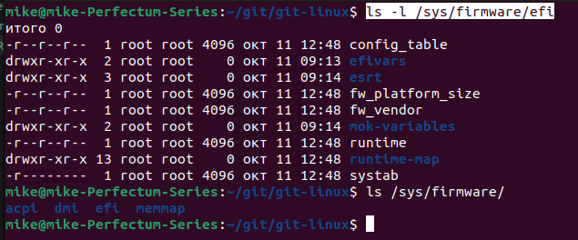

6.6
```
# Просмотр логов ядра предыдущей загрузки:
journalctl -k -b -2
```
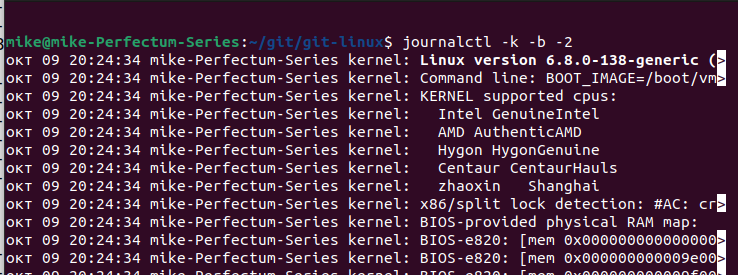

6.7
```
# Просмотр информации о процессоре:
cat /proc/cpuinfo
```
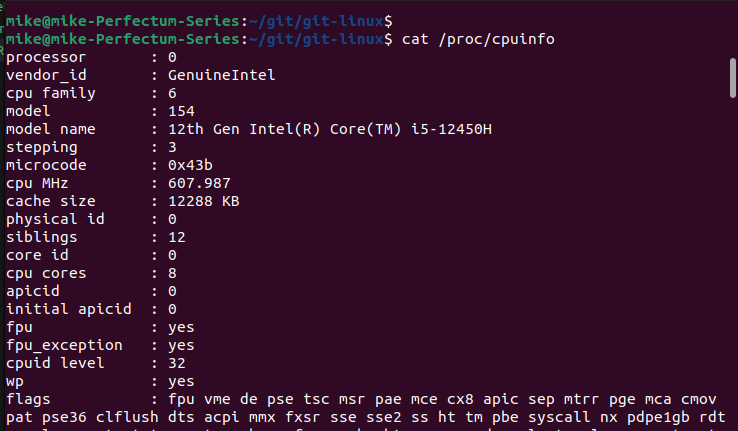

6.8
```
# Просмотр доступных сетевых интерфейсов:
ip a

# Просмотр информации по интерфейсу wlp3s0:
udevadm info -a -p /sys/class/net/wlp3s0
```
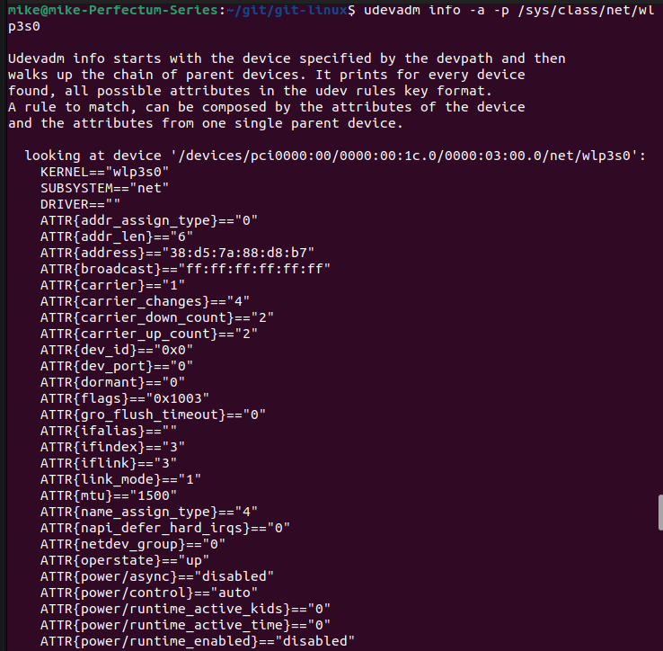

---

## Этап 7. Работа с дисками и файловыми системами

Вы освоите разметку дисков, создание файловых систем, монтирование и работу с LVM и RAID.

№ | Задание	| Пункт из "Содержания"
:--- |:-----:| -------:
7.1	| На «Server» ВМ добавьте виртуальный диск (1 ГБ). С помощью `fdisk` или `parted` создайте на нем таблицу разделов GPT и один раздел на весь диск. | 42.1. Таблицы разделов, 42.2. Создание таблиц и разделов
7.2	| Отформатируйте созданный раздел в файловую систему ext4. | 45.14. Форматирование файловой системы
7.3	| Примонтируйте этот раздел в директорию `/mnt/vdb1` и добавьте запись в `/etc/fstab` для автоматического монтирования. | 45.6. fstab
7.4	| На «Server» ВМ настройте квоты (quota) для пользователя `appuser` на разделе `/mnt/vdb1`. Ограничьте его мягкой квотой в 100 МБ и жесткой в 500 МБ.	| 43. Квотирование файловых систем
7.5	| На «Server» ВМ создайте файл подкачки (swap) размером 1 ГБ и включите его. | 45.13. Файловая система SWAP
7.6	| На «Server» ВМ создайте LVM-том (LV) размером 500 MB в группе томов (VG) `vg_data`. Отформатируйте его в `xfs` и примонтируйте в `/mnt/lvm_data`. | 48. LVM - менеджер логических томов
7.7	| На «Server» ВМ создайте программный RAID 1 из двух дополнительных виртуальных дисков (по 2 ГБ). На массиве создайте файловую систему `ext4` и примонтируйте его в `/mnt/raid`. | 46.2. Сборка RAID, 46.3. Создание файловой системы и монтирование массива
7.8	| На «Client» ВМ проанализируйте использование дискового пространства в системе с помощью `du` и `ncdu`. Найдите 5 самых больших директорий. | 42.3. Освобождение места на диске
7.9	| На «Server» ВМ проверьте состояние диска `vda` с помощью SMART-утилит. | 42.4. HDD tools
7.10 | На «Server» ВМ создайте директорию `/mnt/iso`. С помощью `mount` примонтируйте образ ISO-диска (любой) в эту директорию с опцией `loop`. | 45.4. Монтирование ФС и файлов
7.11 | На «Server» ВМ создайте tmpfs-раздел размером 512 МБ и примонтируйте его в `/mnt/ramdisk`. | 45.11. Специальные ФС (tmpfs)
7.12 | На «Client» ВМ создайте файл `backup.tar`. Используя `tar`, создайте его сжатую версию `backup.tar.gz`. Затем распакуйте её в директорию `backup_extracted`. | 16. Архивация и сжатие файлов
7.13 | На «Server» ВМ с помощью `badblocks` проверьте виртуальный диск на наличие битых секторов. | 42.4.2. badblocks

**Решение**

7.1, 7.2, 7.3
```
# Выбор нового диска для форматирования:
sudo fdisk /dev/vdb

# Задание GPT-таблицы на диске:
g

# Создание нового раздела на весь диск (все значения по умолчанию):
n

# Запись изменений:
w

# Форматирование нового раздела в ФС ext4:
sudo mkfs.ext4 /dev/vdb1

# Создание директории для монтирования раздела:
sudo mkdir /mnt/vdb1

# Монтирование нового раздела в созданную директорию:
sudo mount /dev/vdb1 /mnt/vdb1/

# Просмотр списка примонтированных ФС:
df -h
```
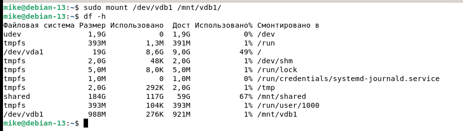
```
# Добавление записи в fstab для автоматического монтирования раздела:
UUID=64583018-9d7f-4e32-9fa3-6b0c2cb4515e       /mnt/vdb1       ext4    defaults        0       0

# Проверить валидность файла:
findmnt --verify --verbose

# Перезагрузить машину и проверить монтирование:
df -h
```
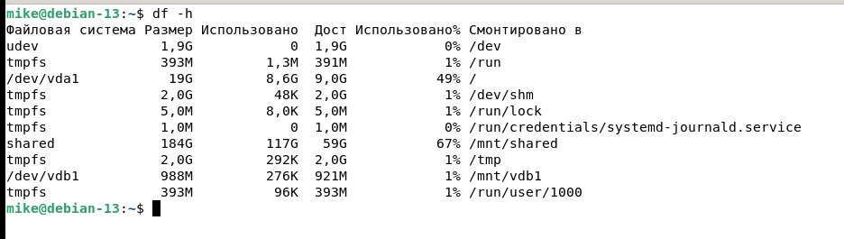

7.4
```
# Для добавления квот на раздел, в файле /etc/fstab необходимо редоктировать опции раздела:
UUID=64583018-9d7f-4e32-9fa3-6b0c2cb4515e       /mnt/vdb1       ext4    defaults,usrquota,grpquota      0      0

# Перезапуск службы:
sudo systemctl daemon-reload

# Установить пакет quota:
sudo apt install quota

# Включить квоты:
sudo quotacheck -ugm /mnt/vdb1

# Выставить квоты для appuser:
sudo edquota -u appuser
```
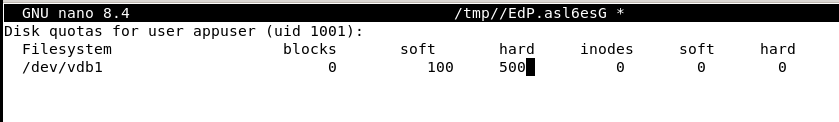

7.5
```
# Создать файл подкачки:
fallocate -l 1G /swapfile

# Задать права на файл:
chmod 600 /swapfile

# Инициализировать swapfile:
sudo mkswap /swapfile

# Включить файл подкачки:
swapon /swapfile

# Посмотреть активные swap-устройства
swapon --show
```
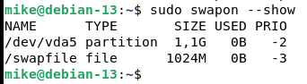

7.6
```
# Установить пакет LVM:
sudo apt install lvm2

# Создать физ.том на жестком диске:
sudo pvcreate /dev/vdc

# Просмотр физических томов:
sudo pvdisplay
```
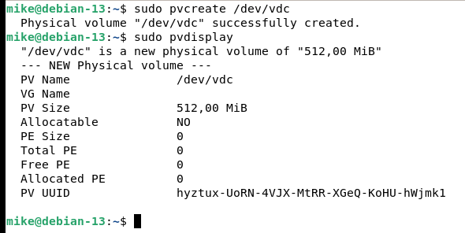
```
# Создать группу myvg томов из физических томов:
vgcreate vg_data /dev/vdc

# Просмотр групп:
sudo vgdisplay
```
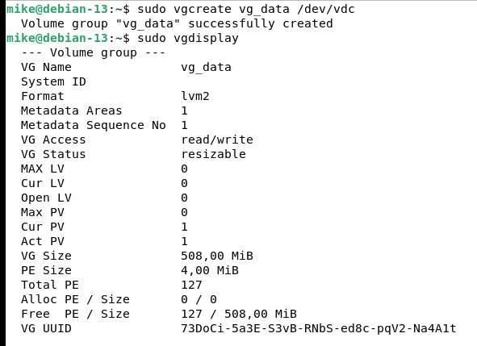
```
# Создание логического тома на все пространство физического тома:
sudo lvcreate -l 100%FREE -n my_lv vg_data

# Просмотр логических томов:
sudo lvdisplay
```
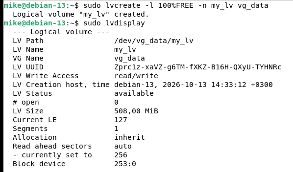
```
# Скачать пакет для работы с XFS:
sudo apt install xfsprogs
# Форматирование логического тома:
sudo mkfs.xfs /dev/vg_data/my_lv
```
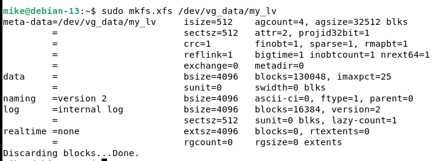
```
# Создание директории для монтирования раздела:
sudo mkdir /mnt/lvm_data

# Монтирование логического раздела:
sudo mount /dev/vg_data/my_lv /mnt/lvm_data

# Просмотр примонтированных ФС:
df -h
```
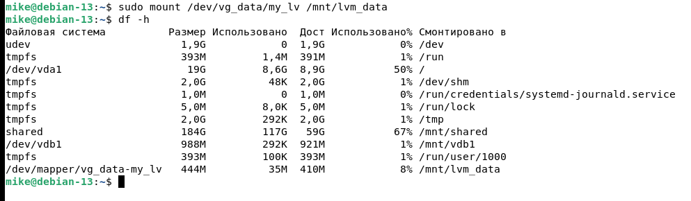

7.7
```
# Установка пакета для работы с RAID:
sudo apt install mdadm

# Создание RAID 1 из 2-х дисков:
sudo mdadm --create --verbose /dev/md0 -l 1 -n 2 /dev/vd{d,e}
```
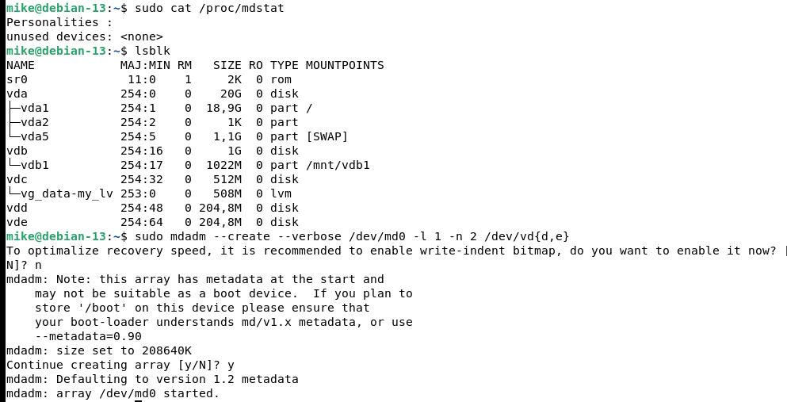
```
# Cоздание файловой системы ext4 на md0:
sudo mkfs.ext4 /dev/md0

# Создание директории для монтирования RAID:
sudo mkdir /mnt/raid

# Монтирование RAID:
sudo mount /dev/md0 /mnt/raid
```
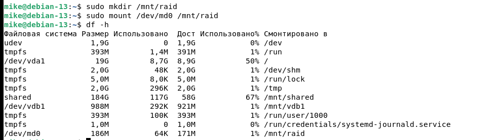
```
# 5 самых больших директорий:
sudo du -hcx --max-depth=6 / | sort -rh | head -n 5
```
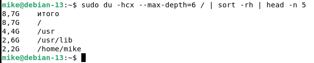
```
# Анализ корня с помощью ncdu:
sudo ncdu /
```
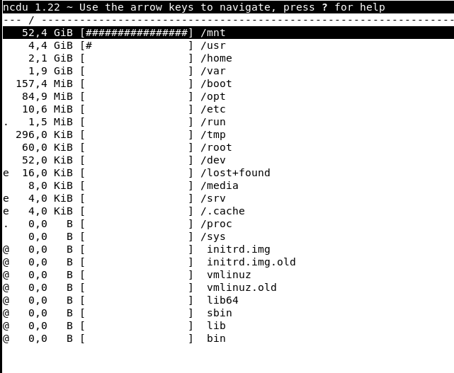

7.9
```
# Запуск gsmartcontrol (на виртуальной машине пример не показателен):
sudo gsmartcontrol
```
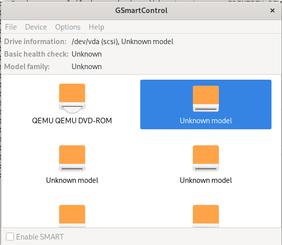

7.10
```
# Создать директорию для монтирования образа:
sudo mkdir /mnt/iso

# Скачать пакет для создания ISO-образов:
sudo apt install genisoimage

# Создать директорию с тестовым содержимым
mkdir -p /tmp/iso-source
echo "Hello from ISO" > /tmp/iso-source/readme.txt

# Создать ISO-образ из этой директории:
genisoimage -o /tmp/test.iso /tmp/iso-source

# Монтирование образа:
sudo mount -o loop /tmp/test.iso /mnt/iso
```


7.11
```
# Создать директорию для монтирования:
sudo mkdir /mnt/ramdisk

# Создать раздел tmpfs и примонтировать его в созданную директорию:
sudo mount -t tmpfs -o size=300M none /mnt/ramdisk
```


7.12
```
# Создать файл:
touch backup.tar

# Сжать файл:
tar -czf backup.tar.gz backup.tar
```

```
# Создать директорию для разархивации:
mkdir ~/backup_extracted

# Разархивация в указанную директорию:
tar -xzf backup.tar.gz -C ~/backup_extracted
```


7.13
```
# Проверка виртуального диска на битые сектора:
sudo badblocks -v /dev/vda
```


---

## Этап 8. Сеть и удаленный доступ

Вы настроите сеть, изучите инструменты для диагностики, настройте SSH и другие сетевые службы.

№ | Задание	| Пункт из "Содержания"
:--- |:-----:| -------:
8.1 | На «Server» ВМ с помощью `ip` и `nmcli` настройте статический IP-адрес на сетевом интерфейсе (например, `192.168.100.10/24`). | 53.1. IP, 53.8. Настройка сети
8.2	| На «Server» ВМ создайте таблицу маршрутизации для двух сетей. Добавьте маршрут для сети `192.168.200.0/24` через шлюз `192.168.100.1`. | 53.2. Маршрутизация
8.3	| На «Client» ВМ с помощью `ss` и `netstat` найдите PID процесса, который слушает порт 22 (SSH). | 53.3. Netstat, 53.10. SS
8.4	| На «Server» ВМ настройте SSH. Смените порт на `2222`, запретите вход под root и разрешите вход только пользователю `devops` (с «Client» ВМ). | 49. SSH
8.5	| Сгенерируйте SSH-ключи и настройте подключение к «Server» ВМ без пароля. Используйте `ssh-copy-id`. | 49.1. Работа с ключами
8.6	| Настройте SSH-туннель для проброса порта с сервера на клиент. Например, чтобы локальный порт `8080` на «Client» ВМ был доступен как `localhost:8080` на «Server» ВМ. | 49.3. SSH-туннель на сторонний хост
8.7	| Настройте обратный SSH-туннель, чтобы «Server» ВМ мог подключаться к «Client» ВМ. | 49.4. Обратный SSH-туннель
8.8	| На «Client» ВМ используйте `ssh` для удаленного выполнения команд на «Server» ВМ, например, hostname и `df -h`. | 49.5. Удалённое выполнение команд
8.9	| На «Client» ВМ с помощью `scp` скопируйте файл `test.txt` с «Client» ВМ на «Server» ВМ. Затем скопируйте его обратно с новым именем. | 52. SCP
8.10 | Настройте SSH-прокси для доступа к веб-интерфейсу, который будет запущен на «Server» ВМ. | 49.2. SSH socks-прокси
8.11 | На «Server» ВМ проверьте DNS-запросы с помощью `nslookup` и `dig`. | 56. DNS

**Решение**

```
# Задать дополнительный статический адрес на интерфейсе:
sudo ip addr add 192.168.100.10/24 dev enp1s0
```


8.2
```
# Задать маршрут к сети через шлюз:
sudo ip route add 192.168.200.0/24 via 192.168.100.1

# Просмотр маршрутов:
ip r
```


8.3
```
# Поиск процесса прослушивающего 22-ой порт:
sudo ss | egrep '.* 22 .*'
```

8.4
```
# Сменить порт для подключения по SSH (с 22-го) в /etc/ssh/sshd_config:
Port 2222

# Разрешить только пользователю devops подключаться по SSH в /etc/ssh/sshd_config добавить:
AllowUsers devops
```

8.5
```
# Генерация SSH-ключей:
ssh-keygen -t ed25519

# Копирование публичного ключа на сервер:
ssh-copy-id -i ./.ssh/ed25519.pub 192.168.122.124 -p 2222

# Проверка входа на сервер по ключу:
ssh -p 2222 192.168.122.124
```


8.6
```
# Перенеправление порта с локальной машины (порт 8080) на удаленный сервер (порт 3000):
ssh -L 8080:192.168.122.124:3000 mike@192.168.122.124 -p 2222
```

8.7
```
# Создание обратного ssh-туннеля, позволяющего попасть на локальную машину извне через сервер:
ssh -R 8080:localhost:80 mike@192.168.122.124 -p 2222

# Теперь, находясь на удаленном сервере выполнить доступ к приложению локальной машины:
curl http://localhost:8080
```


8.8
```
# Удаленное выполнение команд через ssh:
ssh mike@192.168.122.124 "df -h"
```


8.9
```
# Копирование файла с клиента на сервер:
scp -pC test.txt mike@192.168.122.124:/home/mike
```

```
# Копирование этого же файла с сервера на клиент с другим именем:
scp -pCr mike@192.168.122.124:/home/mike/test.txt ./new_test.txt
```


8.10
```
# На клиенте настроить SSH-прокси для доступа к удаленному серверу:
ssh -D 8888 -p 2222 mike@192.168.122.124

# Проверка. На клиенте открыть второй терминал и выполнить:
curl --socks5 localhost:8888 http://localhost:80
```


8.11
```
# Проверить соответствие имени IP-адресу:
nslookup localhost
```

```
# Запрос информации по записи banki.ru у DNS-сервера Google:
dig @8.8.8.8 banki.ru
```


---

## Этап 9. Логирование и мониторинг

Вы научитесь работать с логами, анализировать их и мониторить систему.

№ | Задание	| Пункт из "Содержания"
:--- |:-----:| -------:
9.1	| На «Server» ВМ установите и настройте `rsyslog` для отправки всех логов службы `cron` в отдельный файл `/var/log/cron-custom.log`. | 32.2. Основные компоненты системы логирования
9.2	| На «Client» ВМ используйте `journalctl` для фильтрации логов по приоритету `error` за последний час. | 32.1. Работа с журналом
9.3	| На «Client» ВМ напишите скрипт, который использует `watch` для мониторинга загрузки процессора с помощью `mpstat`. | 67.8. mpstat
9.4	| На «Server» ВМ установите `atop` и `pidstat`. Настройте `atop` для создания срезов состояния каждые 10 минут.	67.10. atop, 67.9. pidstat
9.5	| С помощью `lsof` найдите, какой процесс использует файл `/var/log/syslog`. | 32. Логи

**Решение:**

9.1
```
# Для того, чтобы rsyslog собирал логи cron необходимо в файле /etc/rsyslog.d/50-default.conf раскоментировать строку с cron:
```

```
# В директории /var/log появится файл cron.log:
```


9.2
```
# Отфильтровать логи по приоритету `error` за последний час:
sudo journalctl -p err -S "1 hour ago"
```


9.3
```
# Мониторинг нагрузки на процессор:
sudo watch mpstat
```


9.4
```
# Запустить atop:
atop

# Логи хранятся в /var/log/atop за 28 последних дней
# Конфигурация в файле /etc/default/ato
```

9.5
```
# Просмотр процесса, занимающего файл /var/log/syslog:
sudo lsof /var/log/syslog
```


---

## Этап 10. Безопасность и автоматизация

Вы настроите базовые средства безопасности и автоматизируете задачи.

№ | Задание	| Пункт из "Содержания"
:--- |:-----:| -------:
10.1 | На «Server» ВМ настройте AppArmor для ограничения профиля для запуска веб-приложения (`/usr/bin/python3`).	| 65. БЕЗОПАСНОСТЬ
10.2 | На «Server» ВМ создайте cron-задание для резервного копирования директории `/mnt/data` в `/mnt/backup` каждый день в 3:00 утра. | 66. Crontab
10.3 | На «Server» ВМ создайте одноразовое задание с помощью `at` для перезагрузки системы в 4:00. | 66.1. Команда at
10.4 | На «Client» ВМ с помощью `chage` принудительно истеките пароль для пользователя `devops`, чтобы он сменил его при следующем входе. | 23.2. Настройка пароля chage
10.5 | На «Server» ВМ установите атрибуты `chattr` для файла `/etc/passwd`, чтобы запретить его изменение. Снимите этот атрибут. | 29. Атрибуты файлов

**Решение**

10.1
```
# Создание профиля для приложения (python3):
sudo aa-genprof /usr/bin/python3

# Запустить приложение и поработать в нем

# Прочитать логи:
S

# После завершения работы aa-genprof переведет профиль в режим enforce
```

10.2
```
# Редактировать файл заданий:
crontab -e

# Добавить строку:
0 3 * * * tar -cf /mnt/backup/`date +\%Y\%m\%d`.tar /mnt/data
```	

10.3
```
# Задать пользователю mike опцию NOPASSWD в sudoers

# Задать одноразовую перезагрузку системы в 4:00:
echo "sudo reboot now" | at 4:00
```

10.4
```
# Заставить пользователя изменить пароль при следующем входе в систему:
sudo chage --lastday 0 devops
```

10.5
```
# Запрет на изменение файла /etc/passwd:
sudo chattr +i /etc/passwd

# Убрать запрет:
sudo chattr -i /etc/passwd
```

---

## Этап 11. Диагностика производительности

Вы примените методики и инструменты для поиска узких мест в системе.

№ | Задание	| Пункт из "Содержания"
:--- |:-----:| -------:
11.1 | На «Server» ВМ используйте `stress`, чтобы создать нагрузку на систему: загрузите все ядра процессора на 60 секунд.	| 67.13. Stress
11.2 | На «Server» ВМ во время нагрузки из пункта 11.1 используйте `uptime`, `top`, `mpstat` для определения `load average` и использования процессора.	| 67.7. Практическое применение. Основные инструменты
11.3 | На «Client» ВМ вручную создайте нагрузку на память и проанализируйте вывод `free -m`, чтобы увидеть использование памяти, буфера и кэша.	| 67.7. Практическое применение. Основные инструменты (free)
11.4 | На «Server» ВМ с помощью `iostat` проанализируйте нагрузку на диск (показатели чтения/записи, %util). | 67.7. Практическое применение. Основные инструменты (iostat)


**Решение**

11.1
```
# Проверка количества ядер процессора:
lscpu

# Нагрузить оба ядра на 60 секунд:
stress -c 2 -t 60
```

11.2


---

